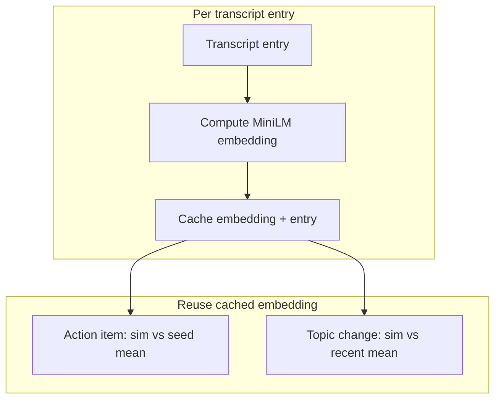
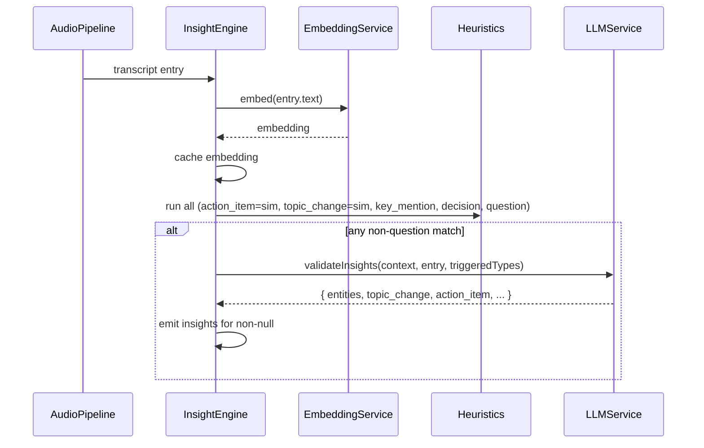

# Action Item Detection Improvements (Revised)

**Architecture:** Shared embedding (D) + unified LLM validation (A) for all non-question insights.

---

## 1. Shared Embedding Pipeline

**Compute embedding once per transcript entry, reuse for action_item + topic_change.**




**New module: `embedding-service.ts**`

- Load `Xenova/all-MiniLM-L6-v2` once (same as [topic-change-detector.ts](desktop/src/main/insights/topic-change-detector.ts))
- `embed(text: string): Promise<Float32Array | null>`
- Rolling cache: `Map<entryId, { embedding, entry }>` with eviction (e.g. last 50 entries or 3 min)
- At init of the app:  precompute embeddings for 20–30 seed action-item phrases; store mean vector
- Expose `cosineSimilarity`, `meanEmbedding` helpers

**Benefits:** O(1) embedding per entry instead of O(N+1) in current topic-change (which re-embeds recent entries every time).

---

## 2. Heuristic Triggers (embedding + existing)


| Insight type     | Trigger                            | Threshold      |
| ---------------- | ---------------------------------- | -------------- |
| **action_item**  | Embedding sim vs seed mean         | > 0.55         |
| **topic_change** | Embedding sim vs recent mean       | < 0.5          |
| **key_mention**  | compromise NER + regex (unchanged) | any match      |
| **decision**     | Heuristic keywords (unchanged)     | any match      |
| **question**     | Keywords + ? + ML gate (unchanged) | stays separate |


---

## 3. Unified LLM Validation

**If any non-question heuristic matches → one LLM call → structured JSON.**

Flow:

1. Run all heuristics (including embedding-based action_item, topic_change)
2. If **any** match (or sim > threshold): trigger LLM
3. LLM receives: transcript context + current entry + which heuristics fired
4. LLM returns single JSON:

```json
{
  "entities": [
    { "type": "person", "text": "Sarah", "metadata": {} },
    { "type": "amount", "text": "$50k", "metadata": {} }
  ],
  "topic_change": true,
  "action_item": "Follow up with engineering by EOD",
  "decision": null,
  "key_mention": null
}
```

- `null` or empty = not valid for that modality
- One call validates and extracts all; we emit only non-null fields

**New method in [llm-service.ts](desktop/src/main/llm/llm-service.ts):** `validateInsights(transcriptContext, entry, triggeredTypes): Promise<UnifiedInsightOutput>`

**Prompt:** *"Given transcript context and a candidate utterance, validate and extract. Respond ONLY with JSON. For each modality that was triggered, output the extracted value or null if not valid. entities: list of {type, text, metadata}. topic_change: bool. action_item: string or null. decision: string or null. key_mention: string or null."*

---

## 4. Question Extraction Stays Separate

- Questions keep: heuristic → ML gate (gray zone) → `validateQuestion` → emit
- No change to question flow

---

## 5. File Changes Summary


| File                                                      | Change                                                                                                                                            |
| --------------------------------------------------------- | ------------------------------------------------------------------------------------------------------------------------------------------------- |
| **New:** `desktop/src/main/insights/embedding-service.ts` | MiniLM init, embed(), cache, seed mean, cosineSimilarity                                                                                          |
| `topic-change-detector.ts`                                | Use embedding-service; remove own pipeline init; accept precomputed embedding                                                                     |
| `heuristic-detector.ts`                                   | Remove ACTION_PHRASES; action_item becomes async, uses embedding (or move to engine)                                                              |
| `insight-engine.ts`                                       | Orchestrate: embed once → run heuristics (action_item via embedding, topic_change via embedding) → if any match → unified LLM → emit per modality |
| `llm-service.ts`                                          | Add `validateInsights()` returning `UnifiedInsightOutput`                                                                                         |
| `index.ts`                                                | Wire new validateInsights; remove per-type validate callbacks for non-questions                                                                   |


---

## 6. Data Flow (Revised)




