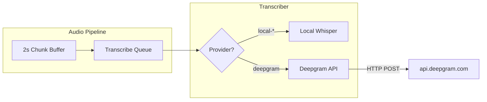

# Add Deepgram Nova 3 as Transcription Provider

## Difficulty: **Medium** (2–3 hours)

The existing architecture is well-suited for this. The pipeline already buffers 2s chunks and calls `transcriber.transcribe()`. Adding Deepgram means implementing a cloud path in the transcriber that posts each chunk to Deepgram's pre-recorded API instead of running local Whisper. No architectural changes required.

---

## Architecture




**Integration approach**: Use Deepgram's **pre-recorded API** (chunk-based), not streaming. The pipeline already produces 2s chunks at 16kHz; we POST each chunk to `https://api.deepgram.com/v1/listen`. This matches the current flow and avoids WebSocket complexity.

---

## Implementation

### 1. Settings and types

**[desktop/src/renderer/src/types/settings.ts](desktop/src/renderer/src/types/settings.ts)**

- Extend `TranscriptionProvider`: add `'deepgram'`
- Extend `TranscriptionSettings`:

```ts
  apiKeys?: { deepgram?: string }
  

```

- Update `DEFAULT_TRANSCRIPTION` with `apiKeys: {}`

**[desktop/src/main/index.ts](desktop/src/main/index.ts)** (lines 50–53, 407–414)

- Add `apiKeys?: { deepgram?: string }` to `TranscriptionSettings`
- In `update-settings`, deep-merge `transcription.apiKeys` when merging transcription settings

### 2. Transcriber – Deepgram provider

**[desktop/src/main/audio/transcriber.ts](desktop/src/main/audio/transcriber.ts)**

- Add `'deepgram'` to `TranscriptionProvider` and `PROVIDER_MODEL_MAP` (map to `null` – no local model)
- Extend `TranscriptionConfig` with `apiKeys?: { deepgram?: string }`
- Update `setProvider(provider, apiKeys?)` to accept optional apiKeys
- In `_initProvider`: for `deepgram`, skip Whisper init; set `_mode = 'deepgram'`
- In `transcribe()`: if provider is `deepgram` and apiKey present, call `_transcribeDeepgram()`
- Implement `_transcribeDeepgram()`:
  - Convert Float32 PCM to Int16 (linear16): `samples[i] * 32767` → `Int16Array`
  - Use `@deepgram/sdk` `transcribeFile()` with `encoding: 'linear16'`, `sample_rate: 16000`, `model: 'nova-3'`
  - Parse transcript from `result.results.channels[0].alternatives[0].transcript`
  - If no apiKey or error, return `{ text: '', duration }`

### 3. Pipeline – pass apiKeys and skip model download

**[desktop/src/main/audio/pipeline.ts](desktop/src/main/audio/pipeline.ts)**

- Extend `TranscriptionSettings` with `apiKeys?: { deepgram?: string }`
- In `onSettingsChanged`: pass full settings (including apiKeys) to `transcriber.setProvider(provider, apiKeys)`
- In `_autoDownloadModel`: skip when provider is `deepgram` (no `PROVIDER_MODEL_MAP` entry)
- In constructor: pass `apiKeys` into Transcriber config

### 4. Settings UI

**[desktop/src/renderer/src/components/SettingsView.tsx](desktop/src/renderer/src/components/SettingsView.tsx)**

- Add to `PROVIDERS`:

```ts
  { id: 'deepgram', label: 'Deepgram', detail: 'Nova 3 (cloud)' }
  

```

- When `transcription.provider === 'deepgram'`:
  - Show password-type input for "Deepgram API Key"
  - Hide model status (no download)
  - On change: `onUpdate({ ...transcription, apiKeys: { ...transcription.apiKeys, deepgram: value } })`
- Ensure `transcription.apiKeys` is initialized when selecting deepgram

### 5. Mode badge

**[desktop/src/renderer/src/components/LiveTranscriptPanel.tsx](desktop/src/renderer/src/components/LiveTranscriptPanel.tsx)** (line 397)

- Add to `MODE_BADGE_MAP`: `'deepgram': { label: 'NOVA', color: 'accent' }`

### 6. Dependency

**[desktop/package.json](desktop/package.json)**

- Add: `"@deepgram/sdk": "^4.x"` (check latest compatible version)

---

## API key storage

Store in `transcription.apiKeys.deepgram` as plain text (same pattern as the earlier plan). For stronger security, you can later mirror the LLM pattern and use Electron `safeStorage` for encryption.

---

## Edge cases

- **Missing API key**: Transcriber returns empty transcript; user sees no transcription until key is set
- **Network errors**: Log and return empty; optional: surface a brief error in the UI
- **Provider switch mid-meeting**: `onSettingsChanged` already hot-swaps; transcriber will use the new provider on the next chunk

---

## Files summary


| File                      | Changes                                          |
| ------------------------- | ------------------------------------------------ |
| `settings.ts`             | Add `deepgram`, `apiKeys`                        |
| `index.ts` (main)         | `TranscriptionSettings` type, deep-merge apiKeys |
| `transcriber.ts`          | Deepgram provider, `_transcribeDeepgram()`       |
| `pipeline.ts`             | Pass apiKeys, skip model download for deepgram   |
| `SettingsView.tsx`        | Deepgram provider + API key input                |
| `LiveTranscriptPanel.tsx` | MODE_BADGE_MAP entry                             |
| `package.json`            | Add `@deepgram/sdk`                              |


