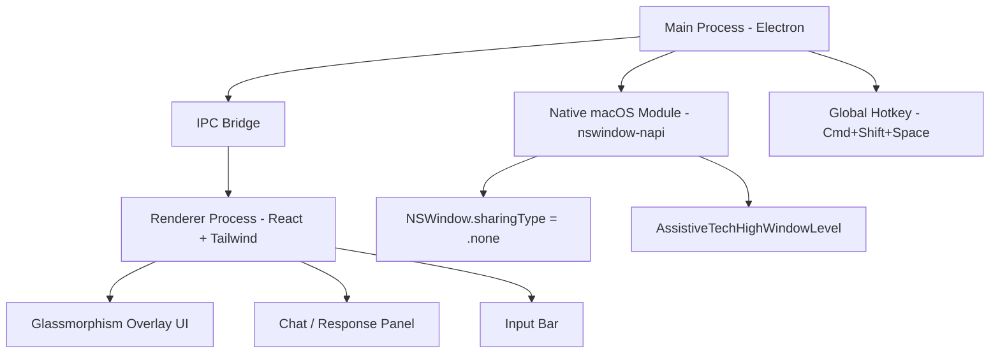

# Cluely-like Electron Overlay App

## Architecture




The app will live at `assistme/desktop/`.

## Tech Stack

- **electron-vite** - Build tool (fast HMR, single config for main/preload/renderer)
- **React 18 + TypeScript** - Renderer UI
- **Tailwind CSS** - Styling (glassmorphism with backdrop-blur)
- **nswindow-napi** - Native macOS module for window-level control and `sharingType` manipulation
- **electron-store** - Persist user preferences

## Screen Sharing Invisibility (macOS)

Two-layer approach using `nswindow-napi`:

1. `**sharingType = .none**` - Prevents legacy window-capture APIs (`CGWindowListCreateImage`) from reading window content
2. `**AssistiveTechHighWindowLevel**` - Moves window to assistive-tech z-index layer, hiding the black rectangle left by step 1

This works against browser-based screen sharing (Chrome, Firefox) and legacy capture. Modern tools like Zoom's latest ScreenCaptureKit-based capture can still see it -- this is the same limitation Cluely has. A toggle hotkey lets users quickly hide the window entirely when needed.

## Window Configuration

```typescript
// Main process - BrowserWindow setup
const win = new BrowserWindow({
  width: 420,
  height: 600,
  transparent: true,
  frame: false,
  alwaysOnTop: true,
  skipTaskbar: true,
  resizable: true,
  hasShadow: false,
  visualEffectState: 'active',
  webPreferences: {
    preload: join(__dirname, '../preload/index.js'),
    contextIsolation: true,
    nodeIntegration: false,
  },
});

// Native window manipulation
const handle = win.getNativeWindowHandle();
NSWindow.SetCollectionBehavior(handle,
  NSWindow.GetNSWindowCollectionBehaviorCanJoinAllSpaces() |
  NSWindow.GetNSWindowCollectionBehaviorStationary() |
  NSWindow.GetNSWindowCollectionBehaviorIgnoresCycle()
);
NSWindow.SetLevel(handle, NSWindow.GetKCGAssistiveTechHighWindowLevel());
win.setContentProtection(true);
```

## Theme System

IDE-style theming with CSS custom properties. Adding a new theme = adding one object to a map.

### Architecture

- `themes/` folder with a `registry.ts` exporting a `Record<string, Theme>` map
- Each theme is a flat object of semantic color tokens (background, surface, border, text, accent, etc.)
- `ThemeProvider` React context injects the active theme's tokens as CSS variables on `:root`
- Tailwind references these variables (e.g., `bg-[var(--surface)]`), so all components are theme-agnostic
- Active theme ID persisted via `electron-store` and restored on launch

### Atom Dark Palette (default)

```typescript
export const atomDark: Theme = {
  id: 'atom-dark',
  name: 'Atom Dark',
  colors: {
    bg: '#1e2127',           // Main window background
    surface: '#282c34',       // Card/panel background
    surfaceHover: '#2c313a',  // Hover state
    border: '#3e4451',        // Borders and dividers
    text: '#abb2bf',          // Primary text
    textMuted: '#5c6370',     // Secondary/placeholder text
    textBright: '#d7dae0',    // Headings, emphasis
    accent: '#61afef',        // Primary accent (buttons, links)
    accentHover: '#528bce',   // Accent hover
    success: '#98c379',       // Success states
    warning: '#e5c07b',       // Warning states
    error: '#e06c75',         // Error states
    inputBg: '#21252b',       // Input field background
    inputBorder: '#3e4451',   // Input border
    chipBg: '#2c313a',        // Action chip background
    chipText: '#abb2bf',      // Action chip text
    overlay: 'rgba(30, 33, 39, 0.85)',  // Glassmorphism overlay bg
  },
};
```

### Adding a New Theme (future)

```typescript
// themes/one-dark-pro.ts
export const oneDarkPro: Theme = {
  id: 'one-dark-pro',
  name: 'One Dark Pro',
  colors: { /* ... palette ... */ },
};

// themes/registry.ts - just add it to the map
import { oneDarkPro } from './one-dark-pro';
export const themes = { 'atom-dark': atomDark, 'one-dark-pro': oneDarkPro };
```

## UI Design (matching Cluely screenshot)

- **Frameless window** with fully transparent background
- **Glassmorphism card**: `bg-[var(--overlay)] backdrop-blur-xl border border-[var(--border)] rounded-2xl`
- **Custom drag region** at the top for window movement
- **Response area**: AI response text in `var(--text-bright)` with clean typography
- **Action chips**: pill buttons using `var(--chip-bg)` / `var(--chip-text)`
- **Input bar**: `var(--input-bg)` background with `var(--text-muted)` placeholder
- **Smooth animations**: fade-in/out on toggle with Framer Motion

## File Structure

```
assistme/desktop/
  electron.vite.config.ts
  package.json
  tsconfig.json
  tailwind.config.ts
  postcss.config.js
  src/
    main/
      index.ts              # Electron main process
      invisibility.ts       # Native window invisibility logic
      hotkey.ts             # Global hotkey registration
    preload/
      index.ts              # Context bridge (IPC exposed to renderer)
    renderer/
      index.html
      src/
        main.tsx            # React entry
        App.tsx             # Root component
        globals.css         # Tailwind imports + glassmorphism utilities
        components/
          Overlay.tsx       # Main overlay container with drag region
          ResponseCard.tsx  # AI response display
          ActionChips.tsx   # Quick action buttons
          InputBar.tsx      # User input field
          TitleBar.tsx      # Custom frameless title bar (close/drag)
        hooks/
          useChat.ts        # Chat state management (placeholder for backend)
        themes/
          types.ts          # Theme type definition
          atom-dark.ts      # Atom Dark palette
          registry.ts       # Theme map (add new themes here)
          ThemeProvider.tsx  # React context, CSS variable injection, persistence
        types/
          index.ts          # Shared type definitions
```

## Global Hotkey

- **Cmd+Shift+Space** - Toggle overlay visibility (show/hide with fade animation)
- When hidden: window is fully hidden (`win.hide()`)
- When shown: window appears with invisibility mode active by default
- IPC channel `toggle-visibility` bridges main process hotkey to renderer animation

## Key Implementation Details

- **Drag region**: A `div` with CSS `-webkit-app-region: drag` at the top of the overlay for window movement
- **No taskbar/dock icon**: `skipTaskbar: true` + set `app.dock.hide()` on macOS to keep it minimal
- **Context isolation**: Secure preload script exposes only specific IPC channels via `contextBridge`
- **Placeholder chat**: The chat/response UI will be wired to the backend (OpenRouter + LangChain) in a future phase
- **Microphone/system audio**: Will be added later using Electron's `desktopCapturer` + Web Audio API

## Dependencies

```json
{
  "dependencies": {
    "nswindow-napi": "^0.0.3",
    "electron-store": "^8.0.0",
    "framer-motion": "^11.0.0"
  },
  "devDependencies": {
    "electron": "^34.0.0",
    "electron-vite": "^3.0.0",
    "@vitejs/plugin-react": "^4.0.0",
    "react": "^18.3.0",
    "react-dom": "^18.3.0",
    "tailwindcss": "^3.4.0",
    "postcss": "^8.0.0",
    "autoprefixer": "^10.0.0",
    "typescript": "^5.5.0",
    "@types/react": "^18.3.0",
    "@types/react-dom": "^18.3.0"
  }
}
```

