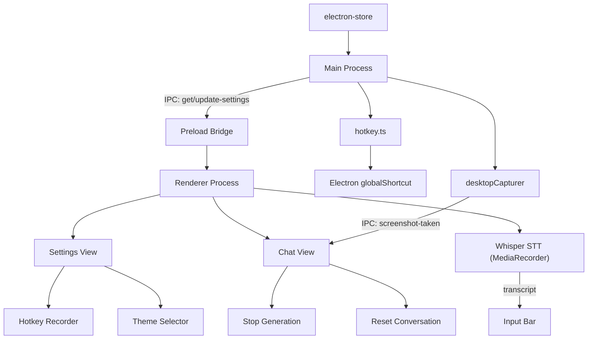
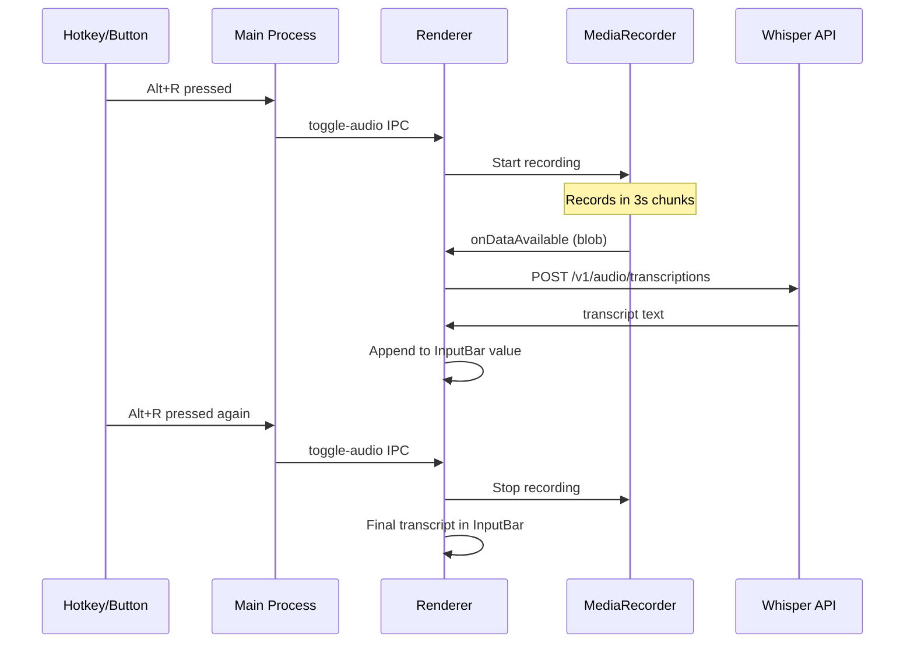

# Configurable Hotkeys, Settings, and Core Features

## Problem

- Current hotkey `Cmd+Shift+Space` conflicts with macOS Spotlight
- No window movement hotkeys exist
- No UI for users to customize hotkeys or preferences
- Only theme ID is persisted; no other settings
- No screenshot capture for visual AI context
- No voice input (speech-to-text)
- No way to reset conversation or stop a response mid-generation

## Architecture




## 1. Settings Type System

Create `[src/renderer/src/types/settings.ts](desktop/src/renderer/src/types/settings.ts)`:

```typescript
export interface HotkeyConfig {
  toggleOverlay: string     // default: 'Alt+T'
  moveUp: string            // default: 'Alt+Up'
  moveDown: string          // default: 'Alt+Down'
  moveLeft: string          // default: 'Alt+Left'
  moveRight: string         // default: 'Alt+Right'
  takeScreenshot: string    // default: 'Alt+S'
  toggleAudio: string       // default: 'Alt+A'
  resetChat: string         // default: 'Alt+R'

}

export interface AppSettings {
  themeId: string
  hotkeys: HotkeyConfig
  moveStepPx: number        // pixels per arrow press, default 50
  windowOpacity: number     // 0.3 - 1.0, default 0.85
}

// Extend ChatMessage to support image attachments
export interface ChatAttachment {
  type: 'image'
  data: string              // base64 data URL
  label?: string            // e.g. "Screenshot"
}
```

Also update `ChatMessage` in `[types/index.ts](desktop/src/renderer/src/types/index.ts)` to include optional `attachments: ChatAttachment[]`.

Note: Electron uses `Alt` for the Option key on macOS in accelerator strings.

## 2. Extend electron-store Schema

In `[src/main/index.ts](desktop/src/main/index.ts)`, replace the simple `themeId` store with the full `AppSettings` defaults:

```typescript
const store = new Store<AppSettings>({
  defaults: {
    themeId: 'atom-dark',
    hotkeys: {
      toggleOverlay: 'Alt+T',
      moveUp: 'Alt+Up',
      moveDown: 'Alt+Down',
      moveLeft: 'Alt+Left',
      moveRight: 'Alt+Right',
      takeScreenshot: 'Alt+S',
      toggleAudio: 'Alt+A',
      resetChat: 'Alt+R',
    },
    moveStepPx: 50,
    windowOpacity: 0.85,
  },
})
```

## 3. Rewrite Hotkey Manager

Rewrite `[src/main/hotkey.ts](desktop/src/main/hotkey.ts)` to support:

- **Dynamic registration**: Accept hotkey config, register all shortcuts
- **Re-registration**: `updateHotkeys(oldConfig, newConfig, win)` that unregisters old keys and registers new ones
- **Move logic**: Arrow hotkeys call `win.setPosition(x + step, y)` etc., reading `moveStepPx` from store
- **Toggle logic**: Same show/hide + IPC pattern as current, just configurable key
- **Screenshot hotkey**: Triggers `desktopCapturer` capture, sends result to renderer via IPC
- **Audio hotkey**: Sends `toggle-audio` IPC to renderer to start/stop recording

Key function signatures:

```typescript
export function registerAllHotkeys(win: BrowserWindow, settings: AppSettings): void
export function unregisterAllHotkeys(): void
export function reregisterHotkeys(win: BrowserWindow, settings: AppSettings): void
```

## 4. New IPC Channels

Add to `[src/main/index.ts](desktop/src/main/index.ts)` and `[src/preload/index.ts](desktop/src/preload/index.ts)`:


| Channel            | Direction                 | Purpose                                                    |
| ------------------ | ------------------------- | ---------------------------------------------------------- |
| `get-settings`     | renderer -> main (invoke) | Returns full `AppSettings`                                 |
| `update-settings`  | renderer -> main (send)   | Partial update, persists + re-registers hotkeys if changed |
| `take-screenshot`  | renderer -> main (invoke) | Triggers desktopCapturer, returns base64 PNG               |
| `screenshot-taken` | main -> renderer (send)   | Pushes screenshot when triggered by hotkey                 |
| `toggle-audio`     | main -> renderer (send)   | Tells renderer to start/stop mic recording                 |
| `cancel-response`  | renderer -> main (send)   | Signals main to abort current AI response                  |


reset-chat | rendered -> main -> reset the chat to empty state  
  
  
Remove the old `get-theme-id` / `set-theme-id` channels since settings now includes `themeId`.

Update the preload `ElectronAPI` interface:

```typescript
getSettings: () => Promise<AppSettings>
updateSettings: (partial: Partial<AppSettings>) => void
takeScreenshot: () => Promise<string>          // returns base64 data URL
onScreenshotTaken: (cb: (data: string) => void) => () => void
onToggleAudio: (cb: () => void) => () => void
cancelResponse: () => void
```

## 5. Settings View UI

### 5a. Gear Icon in TitleBar

Modify `[src/renderer/src/components/TitleBar.tsx](desktop/src/renderer/src/components/TitleBar.tsx)`:

- Add a gear icon (SVG, no extra deps) between the title and the spacer
- `onClick` dispatches a `setView('settings')` state change
- Style: same `var(--text-muted)` color, `no-drag` region

### 5b. View Router in Overlay

Modify `[src/renderer/src/components/Overlay.tsx](desktop/src/renderer/src/components/Overlay.tsx)`:

- Add a `view` state: `'chat' | 'settings'`
- Pass `view` / `setView` to `TitleBar` (gear icon toggles it)
- Conditionally render chat content vs `<SettingsView />` based on `view`
- TitleBar shows a back arrow when in settings view

### 5c. SettingsView Component

Create `[src/renderer/src/components/SettingsView.tsx](desktop/src/renderer/src/components/SettingsView.tsx)`:

**Sections:**

1. **Hotkeys** -- Each hotkey has a label + a `HotkeyRecorder` widget
2. **Theme** -- Dropdown or grid of theme swatches (uses existing `useTheme()`)
3. **Window** -- Opacity slider + move step size slider

**Hotkey Recorder Widget** (`HotkeyRecorder.tsx`):

- When focused/clicked, enters "recording" mode (pulsing border)
- Listens for `keydown`, converts the event to Electron accelerator string (e.g., `Alt+Shift+K`)
- Maps `event.metaKey` -> `Command`, `event.altKey` -> `Alt`, `event.ctrlKey` -> `Control`, `event.shiftKey` -> `Shift` + `event.code` -> key name
- Displays current binding as a styled kbd badge
- "Reset to default" button per hotkey

**Settings Persistence Flow:**

1. User changes a value in SettingsView
2. Component calls `window.electronAPI.updateSettings({ hotkeys: { ... } })`
3. Main process updates electron-store and calls `reregisterHotkeys()` if hotkeys changed
4. Main process sends `settings-changed` IPC back to all renderers so UI stays in sync

## 6. Screenshot Capture

### Main process (`[src/main/screenshot.ts](desktop/src/main/screenshot.ts)` -- new file)

Uses Electron's `desktopCapturer` to capture the full screen:

```typescript
import { desktopCapturer, BrowserWindow } from 'electron'

export async function captureScreen(win: BrowserWindow): Promise<string> {
  // Hide our overlay temporarily so it's not in the screenshot
  const wasVisible = win.isVisible()
  if (wasVisible) win.hide()

  // Small delay for the window to fully disappear
  await new Promise(r => setTimeout(r, 100))

  const sources = await desktopCapturer.getSources({
    types: ['screen'],
    thumbnailSize: { width: 1920, height: 1080 },
  })

  if (wasVisible) win.show()

  const primary = sources[0]
  if (!primary) throw new Error('No screen source found')

  return primary.thumbnail.toDataURL()
}
```

### Flow

**Hotkey-triggered**: Screenshot hotkey -> main calls `captureScreen()` -> sends `screenshot-taken` IPC to renderer -> renderer adds image to chat as a `ChatAttachment` on a new user message.

**Button-triggered**: User clicks camera icon in InputBar -> renderer calls `window.electronAPI.takeScreenshot()` -> same flow.

### Renderer UI changes

- Add a camera/screenshot icon button in `[InputBar.tsx](desktop/src/renderer/src/components/InputBar.tsx)` next to the send button
- When a screenshot is attached, show a small thumbnail preview above the input with an "x" to remove
- `useChat.sendMessage()` updated to accept optional `attachments` array
- `[ResponseCard.tsx](desktop/src/renderer/src/components/ResponseCard.tsx)` renders image attachments inline in the message bubble

## 7. Real-time Whisper Speech-to-Text

### Architecture




### Implementation

Create `[src/renderer/src/hooks/useWhisperSTT.ts](desktop/src/renderer/src/hooks/useWhisperSTT.ts)`:

- Uses browser `MediaRecorder` API (available in Electron's Chromium)
- Records audio in chunks (every ~3 seconds) for near-real-time transcription
- Each chunk is sent as a `FormData` POST to the OpenAI-compatible Whisper endpoint (`/v1/audio/transcriptions`)
- Whisper model: `whisper-1` (or self-hosted endpoint, configurable later)
- Returns `{ isRecording, transcript, startRecording, stopRecording, clearTranscript }`
- Transcript text is streamed into the InputBar as it arrives (user can edit before sending)

### UI changes

- Mic icon button in `[InputBar.tsx](desktop/src/renderer/src/components/InputBar.tsx)` -- red pulsing dot when recording
- Listen for `onToggleAudio` IPC from hotkey to trigger start/stop
- InputBar shows a waveform indicator or "Recording..." badge when active

### API Key

For now, the Whisper API key will be a hardcoded placeholder or read from environment. This will be wired to the backend's LLM service in a future phase (the backend already has OpenAI/OpenRouter provider support from the project architecture).

## 8. Reset Conversation and Stop Generation

### Reset Conversation

- Add `resetChat()` to `[useChat.ts](desktop/src/renderer/src/hooks/useChat.ts)` -- clears `messages` array and resets `isLoading`
- Add a trash/reset icon button in the TitleBar or as a toolbar row above InputBar
- Confirmation not needed (it's a lightweight overlay, not persistent storage yet)

### Stop Generation

- Add `stopGeneration()` to `[useChat.ts](desktop/src/renderer/src/hooks/useChat.ts)` -- sets `isLoading = false`, sends `cancel-response` IPC
- Add a stop button (square icon) that replaces the send button in InputBar when `isLoading` is true
- Main process: on `cancel-response` IPC, abort any pending response timer (placeholder) or `AbortController` (future backend streaming)
- The partial response already received stays in the chat

### UI

A small toolbar row between ActionChips and InputBar (or integrated into InputBar):

```
[ camera icon ] [ mic icon (red when recording) ] [ reset icon ] ---- [ stop/send button ]
```

## 9. Update ThemeProvider

Modify `[src/renderer/src/themes/ThemeProvider.tsx](desktop/src/renderer/src/themes/ThemeProvider.tsx)`:

- Replace `get-theme-id` / `set-theme-id` calls with `getSettings()` / `updateSettings()`
- Theme changes go through the unified settings system
- Keep localStorage fallback for FOUC prevention

## 10. Files Changed Summary


| File                                             | Action                                                             |
| ------------------------------------------------ | ------------------------------------------------------------------ |
| `src/main/index.ts`                              | Extend store schema, new IPC handlers, remove old theme IPC        |
| `src/main/hotkey.ts`                             | Full rewrite: dynamic multi-hotkey, move, screenshot, audio toggle |
| `src/main/screenshot.ts`                         | **New** -- desktopCapturer full-screen capture logic               |
| `src/preload/index.ts`                           | New APIs: settings, screenshot, audio toggle, cancel               |
| `src/renderer/src/types/settings.ts`             | **New** -- AppSettings, HotkeyConfig, ChatAttachment               |
| `src/renderer/src/types/index.ts`                | Update ChatMessage with attachments, re-export settings            |
| `src/renderer/src/hooks/useChat.ts`              | Add resetChat(), stopGeneration(), attachments support             |
| `src/renderer/src/hooks/useWhisperSTT.ts`        | **New** -- MediaRecorder + Whisper API streaming STT               |
| `src/renderer/src/components/TitleBar.tsx`       | Gear icon, back arrow, reset button                                |
| `src/renderer/src/components/Overlay.tsx`        | View routing (chat/settings), audio IPC listener                   |
| `src/renderer/src/components/InputBar.tsx`       | Camera, mic, stop/send button, screenshot preview                  |
| `src/renderer/src/components/ResponseCard.tsx`   | Render inline image attachments                                    |
| `src/renderer/src/components/SettingsView.tsx`   | **New** -- full settings panel                                     |
| `src/renderer/src/components/HotkeyRecorder.tsx` | **New** -- keyboard shortcut recorder widget                       |
| `src/renderer/src/themes/ThemeProvider.tsx`      | Use unified settings API                                           |


## Future Feature Ideas

- **Window position presets**: Snap overlay to corners/edges with hotkeys
- **Auto-hide timer**: Hide after N seconds of inactivity
- **Clipboard watch mode**: Auto-analyze copied code
- **Quick-paste to active app**: Hotkey to paste AI response into the previously-focused app
- **Response history**: Persist chat across sessions
- **Multi-monitor support**: Per-display positioning

