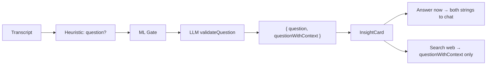

# Insight Quality Improvements

## Current State

**Key mentions**: The heuristic detector fires on any NER match (name, date, amount) and the LLM `validateInsights` returns a `key_mention` string. But the LLM prompt only asks for "key mention text if valid" — it doesn't ask for contextual enrichment. Result: you get `"key_mention": "Adrian Monk"` with no context about *why* that person matters.

**Questions**: The `validateQuestion` LLM call returns a single string — the extracted question. This is used as both the display text and the payload for "Answer now" and "Search the web" actions. But a raw transcript question like *"What's the timeline?"* is useless for web search without context. The LLM has the transcript context and could return something like *"What is the timeline for the Q3 product launch?"*.

## Changes

### 1. Improve `validateQuestion` to return both raw and contextual question

In [desktop/src/main/llm/llm-service.ts](desktop/src/main/llm/llm-service.ts) (`validateQuestion`, ~line 889):

- Change the LLM prompt to ask for two fields:
  ```json
  {
    "question": "<exact question from transcript>",
    "question_with_context": "<self-contained question with context from the meeting>"
  }
  ```
- Change return type from `string | null` to `{ question: string; questionWithContext: string } | null`
- The `question` field is the verbatim transcript question (e.g. "What's the timeline?")
- The `question_with_context` field is a self-contained rewrite using meeting context (e.g. "What is the timeline for the Q3 product launch?")

### 2. Improve `validateInsights` LLM prompt for richer key_mention

In [desktop/src/main/llm/llm-service.ts](desktop/src/main/llm/llm-service.ts) (`validateInsights`, ~line 793):

- Update the `key_mention` instruction in the system prompt from:
  > `key_mention: key mention text if valid (amounts, dates, names, URLs), else null`
- To:
  > `key_mention: a short contextual description of why this mention matters (e.g. "Adrian Monk — lead detective on the case" or "$2.5M — proposed budget for Q3 marketing"), else null`
- No type changes needed — `key_mention` is already `string | null`

### 3. Re-enable key_mention heuristic detection

In [desktop/src/main/insights/heuristic-detector.ts](desktop/src/main/insights/heuristic-detector.ts) (~line 202):

- Uncomment the key_mention detection block that was just disabled

### 4. Thread the two question strings through the engine

In [desktop/src/main/insights/insight-engine.ts](desktop/src/main/insights/insight-engine.ts):

- Update the `validate` callback type in `InsightEngineConfig` to return `{ question: string; questionWithContext: string } | null` instead of `string | null`
- In `emitInsight`, when the LLM confirms a question, store both strings:
  - `event.text` = raw question (for display: "What's the timeline?")
  - `event.metadata.questionWithContext` = contextual question
- In `buildDefaultActions` for questions:
  - "Answer now" payload = both questions (raw + contextual) so the chat gets full context
  - "Search the web" payload = `questionWithContext` only (better search query)
  - "Suggest follow-up" payload = `questionWithContext`

### 5. Update the Insight type and renderer

In [desktop/src/main/insights/types.ts](desktop/src/main/insights/types.ts) and [desktop/src/renderer/src/types/insights.ts](desktop/src/renderer/src/types/insights.ts):

- Add optional `questionWithContext?: string` to the `Insight` interface (keeps backward compat)

In [desktop/src/renderer/src/components/InsightsWindow.tsx](desktop/src/renderer/src/components/InsightsWindow.tsx):

- For question insights, display the contextual question as the description (instead of the raw transcript text)
- The raw question is still available in `insight.title` (e.g. "Them asked a question")

### 6. Update `index.ts` wiring

In [desktop/src/main/index.ts](desktop/src/main/index.ts) (~line 182):

- Update the `validate` callback to match the new return type from `validateQuestion`

## Data Flow (Questions)


