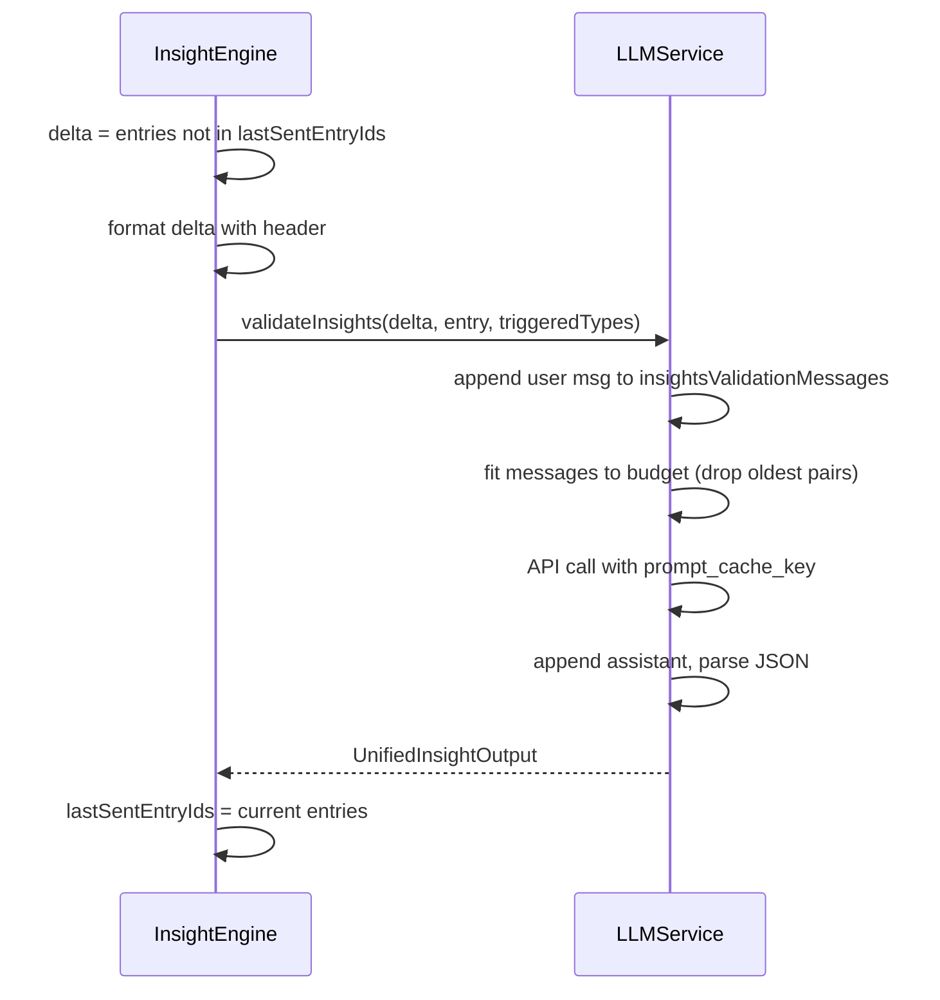

# Insights LLM Validation Improvements

## 1. Output Schema: `topic` instead of `topic_change`

**Current:** `topic_change: true | false` (boolean)

**New:** `topic: string` — when the utterance starts a new topic, return the topic label (e.g. "Budget discussion", "Timeline review"); when it continues the same topic, return `"N/A"`.

**Files to change:**

- [desktop/src/main/llm/llm-service.ts](desktop/src/main/llm/llm-service.ts) — update system prompt and response parsing
- [desktop/src/main/insights/types.ts](desktop/src/main/insights/types.ts) — `UnifiedInsightOutput.topic_change` → `topic: string`
- [desktop/src/main/insights/insight-engine.ts](desktop/src/main/insights/insight-engine.ts) — emit `topic_change` insight when `result.topic !== "N/A"` (and use `result.topic` as description)

---

## 2. Conversation History + Transcript Delta (Append-Only)

Mirror the main chat flow: keep a conversation for insights validation, append-only, with transcript delta only in each new user message.

**Flow:**

```
messages[0]: system (stable, never changes)
messages[1]: user — "Transcript: [full on first call]\n\nCandidate: X\n\nTypes: ..."
messages[2]: assistant — JSON
messages[3]: user — "Transcript (continued): [delta only]\n\nCandidate: Y\n\nTypes: ..."
messages[4]: assistant — JSON
...
```

**Transcript delta rules:**

- First call: full transcript context with header `MEETING TRANSCRIPT:`
- Subsequent calls: only entries not sent in the previous user message, header `NEW TRANSCRIPT SINCE LAST MESSAGE:`
- Same format as [useChat.ts](desktop/src/renderer/src/hooks/useChat.ts) (`buildMessageContent`)

**Implementation:**

### 2a. InsightEngine: track last-sent entries, build delta

- Add `lastSentEntryIds: Set<string>` (reset in `reset()`)
- Before calling `validateInsights`: compute `deltaEntries = recentTranscriptEntries.filter(e => !lastSentEntryIds.has(e.id))`
- Format delta: `formatTranscriptDelta(deltaEntries)` with appropriate header (first vs continued)
- After successful call: `lastSentEntryIds = new Set(recentTranscriptEntries.map(e => e.id))`
- Change config signature: `validateInsights(transcriptDelta: string, entry, triggeredTypes)` — caller provides the delta string

### 2b. LLMService: maintain insights conversation, fit budget

- Add `insightsValidationMessages: Array<{ role: 'user' | 'assistant'; content: string }>`
- On each `validateInsights` call:
  1. Build user content: `transcriptDelta + "\n\nCandidate utterance (speaker: X): \"...\"\n\nTriggered modalities: ..."`
  2. Append `{ role: 'user', content }` to `insightsValidationMessages`
  3. Call API with `messages: [system, ...fittedHistory, user]` where `fittedHistory` is truncated to fit context budget (drop oldest user+assistant pairs, like [PromptAssembler.fitMessages](desktop/src/main/llm/prompt-assembler.ts))
  4. Append assistant response to `insightsValidationMessages`
  5. Return parsed JSON
- Context budget: use `TokenCounter` and a budget (e.g. 100k tokens for insights conversation). Reuse the truncation logic from PromptAssembler (drop oldest pairs, prepend truncation note to first remaining user message if needed).

### 2c. Reset on meeting end

- Add `llmService.resetInsightsValidation()` — clears `insightsValidationMessages`
- In [index.ts](desktop/src/main/index.ts) `setOnSessionStop` callback: call `llmService.resetInsightsValidation()` alongside `insightEngine.reset()`

---

## 3. OpenAI Prefix Caching

- Use `prompt_cache_key: \`insights-${this.sessionId}` — separate from main chat (different system prompt), stable within app session
- Do **not** change the cache key based on transcript content — keep it stable
- Append-only messages ensure the prefix (system + previous turns) is cacheable; only the new user message is uncached

---

## 4. Data Flow (Revised)




---

## 5. File Changes Summary


| File                                                             | Change                                                                                                                             |
| ---------------------------------------------------------------- | ---------------------------------------------------------------------------------------------------------------------------------- |
| [types.ts](desktop/src/main/insights/types.ts)                   | `topic_change: boolean` → `topic: string` in `UnifiedInsightOutput`                                                                |
| [insight-engine.ts](desktop/src/main/insights/insight-engine.ts) | Add `lastSentEntryIds`, build transcript delta, update config signature, emit when `topic !== "N/A"`                               |
| [llm-service.ts](desktop/src/main/llm/llm-service.ts)            | Add `insightsValidationMessages`, history + truncation, `topic` in prompt/parsing, `prompt_cache_key`, `resetInsightsValidation()` |
| [index.ts](desktop/src/main/index.ts)                            | Wire `validateInsights` with new signature; call `resetInsightsValidation()` in `setOnSessionStop`                                 |


---

## 6. Edge Cases

- **First call:** `lastSentEntryIds` is empty → delta includes all entries (full context), header "MEETING TRANSCRIPT:"
- **No new entries:** delta can be empty string; header "NEW TRANSCRIPT SINCE LAST MESSAGE:" with empty body — LLM still has full history in previous turns
- **Meeting reset:** `lastSentEntryIds` cleared in `insightEngine.reset()`, `insightsValidationMessages` cleared in `llmService.resetInsightsValidation()`

