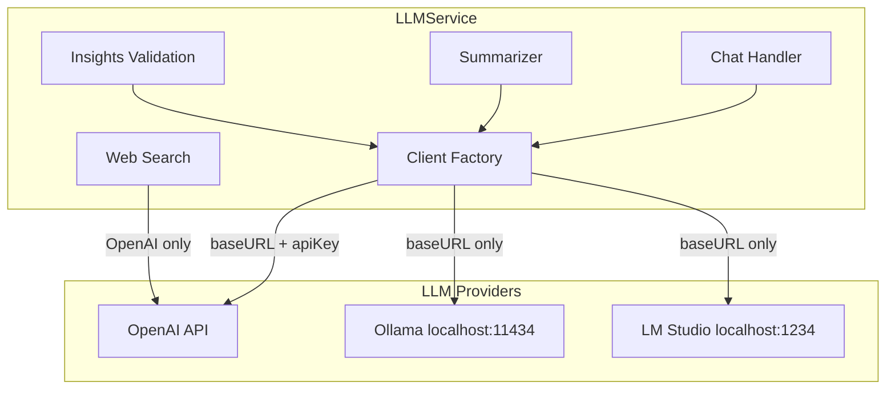

# Local LLM Integration (Ollama / LM Studio)

## Feasibility Summary

**Difficulty: Moderate** — Most LLM calls use standard `chat.completions.create`, which both Ollama and LM Studio support natively. The main work is provider abstraction, UI changes, and handling OpenAI-only features (web search, prefix caching).

---

## Architecture Overview

---

## What Works Out of the Box

Both Ollama and LM Studio expose **OpenAI-compatible** Chat Completions APIs:

| Feature                    | OpenAI | Ollama            | LM Studio           |
| -------------------------- | ------ | ----------------- | ------------------- |
| Chat (streaming)           | Yes    | Yes               | Yes                 |
| System + user messages     | Yes    | Yes               | Yes                 |
| Background summarization   | Yes    | Yes               | Yes                 |
| Insights validation (JSON) | Yes    | Yes               | Yes                 |
| Follow-up suggestions      | Yes    | Yes               | Yes                 |
| Vision (screenshots)       | Yes    | Yes (llava, etc.) | Yes (vision models) |
| Web search                 | Yes    | **No**            | **No**              |
| Prefix caching             | Yes    | No                | No                  |
| reasoning_effort           | Yes    | Ignored           | Ignored             |

---

## Implementation Plan

### 1. Provider Abstraction Layer

**Files:** [desktop/src/main/llm/llm-service.ts](desktop/src/main/llm/llm-service.ts), new `desktop/src/main/llm/provider-config.ts`

- Add `LLMProvider` type: `'openai' | 'ollama' | 'lmstudio'`
- Add provider config: base URL, api key required (false for local), default models
- Create client factory: `createLLMClient(provider, baseUrl?, apiKey?)` returning OpenAI-compatible client
- For local: `new OpenAI({ baseURL: 'http://localhost:11434/v1', apiKey: 'ollama' })` (Ollama) or `http://localhost:1234/v1` (LM Studio)

### 2. Strip OpenAI-Specific Parameters

When provider is local, omit from all `chat.completions.create` calls:

- `reasoning_effort` — local models ignore it; omitting is safe
- `prompt_cache_key` — OpenAI-only
- `prompt_cache_retention` — OpenAI-only

**Files:** [llm-service.ts](desktop/src/main/llm/llm-service.ts), [background-summarizer.ts](desktop/src/main/llm/background-summarizer.ts), [follow-up-suggestions.ts](desktop/src/main/llm/follow-up-suggestions.ts)

### 3. Model Configuration

**Current:** Fixed `gpt5-nano`, `gpt5-mini`, `gpt-5.2` with 400k context.

**Local:** Dynamic model list with smaller context windows (typically 4k–128k).

- **Ollama:** Fetch via `GET http://localhost:11434/api/tags` → `models[].name`
- **LM Studio:** Fetch via `GET http://localhost:1234/v1/models` (OpenAI-compatible)
- Add `contextWindow` and `maxResponseTokens` per model (Ollama/LM Studio return `max_context_length` in metadata)
- Fallback: allow manual model name input if fetch fails (Ollama not running, etc.)

**Files:** [settings.ts](desktop/src/renderer/src/types/settings.ts), [LLMView.tsx](desktop/src/renderer/src/components/LLMView.tsx), new IPC `llm:list-local-models`

### 4. Web Search Handling

**Current:** Uses OpenAI Responses API with `web_search` tool — cloud-only.

**Options:**

- **A) Disable for local:** When provider is Ollama/LM Studio, hide "Search the web" in UI and return `{ error: 'Web search requires OpenAI' }` for web-search IPC. Simplest.
- **B) Alternative search:** Integrate Tavily, Brave Search, or Serper API + local LLM synthesis. Adds dependency and API key for search provider.

**Recommendation:** Start with Option A. Add Option B later if desired.

**Files:** [web-search.ts](desktop/src/main/llm/web-search.ts), [llm-service.ts](desktop/src/main/llm/llm-service.ts), [LiveInsightsPanel.tsx](desktop/src/renderer/src/components/LiveInsightsPanel.tsx), [InputBar.tsx](desktop/src/renderer/src/components/InputBar.tsx)

### 5. Vision (Screenshot Attachments)

- Ollama supports vision via `llava`, `llava:13b`, etc. Same message format: `content: [{ type: 'image_url', image_url: { url: 'data:image/...' } }]`
- LM Studio supports vision models when loaded
- **Behavior:** If user attaches image but selected model is not vision-capable, either: (a) show warning and skip image, or (b) require vision model when attachment present. Option (a) is simpler.

### 6. Settings UI Changes

**Files:** [LLMView.tsx](desktop/src/renderer/src/components/LLMView.tsx), [OnboardingView.tsx](desktop/src/renderer/src/components/OnboardingView.tsx)

- Add provider selector: **OpenAI** | **Ollama** | **LM Studio**
- When **OpenAI:** Show API key input (current behavior)
- When **Ollama/LM Studio:** Hide API key; show base URL (editable, default `localhost:11434` / `localhost:1234`); show "Refresh models" button
- Model dropdown: For OpenAI → fixed list; For local → dynamic list from `/api/tags` or `/v1/models`
- Usage/cost: When local, show "Free (local)" instead of estimated cost

### 7. Langfuse Tracing

**Current:** `observeOpenAI(client)` wraps the OpenAI client for tracing.

- For local providers: Either skip `observeOpenAI` (no tracing) or use a generic span. Simplest: only wrap when provider is `openai`.

**File:** [llm-service.ts](desktop/src/main/llm/llm-service.ts)

### 8. Connection Validation

- Add "Test connection" for local providers: `GET /api/tags` (Ollama) or `GET /v1/models` (LM Studio) to verify server is running
- Show status: "Connected" / "Ollama not running" / "LM Studio not running"

---

## File Change Summary

| File                           | Changes                                                                                      |
| ------------------------------ | -------------------------------------------------------------------------------------------- |
| `llm/provider-config.ts`       | New: provider types, base URLs, client factory                                               |
| `llm/llm-service.ts`           | Provider selection, client init, strip OpenAI params, web-search guard, Langfuse conditional |
| `llm/background-summarizer.ts` | Strip `reasoning_effort` when local                                                          |
| `llm/follow-up-suggestions.ts` | Strip `reasoning_effort` when local                                                          |
| `llm/web-search.ts`            | Return error when provider is local (or add optional search API)                             |
| `types/settings.ts`            | Add `llm.provider`, `llm.localBaseUrl`, extend model types                                   |
| `LLMView.tsx`                  | Provider selector, conditional API key, model refresh, local status                          |
| `OnboardingView.tsx`           | Mention local option, conditional API key                                                    |
| `preload/index.ts`             | Add `llm:list-local-models`, `llm:test-local-connection`                                     |
| `insight-engine.ts`            | Hide "Search the web" action when local (or handle error)                                    |
| `LiveInsightsPanel.tsx`        | Conditionally show search button                                                             |
| `InputBar.tsx`                 | Conditionally show search chip                                                               |

---

## Effort Estimate

| Task                                          | Effort     |
| --------------------------------------------- | ---------- |
| Provider abstraction + client factory         | 2–3 hours  |
| Strip OpenAI params, conditional Langfuse     | 1 hour     |
| Model listing API + IPC                       | 1–2 hours  |
| Settings migration + UI (LLMView, Onboarding) | 2–3 hours  |
| Web search disable for local                  | 0.5 hour   |
| Vision compatibility check                    | 0.5–1 hour |
| Testing (Ollama + LM Studio)                  | 1–2 hours  |

**Total: ~8–12 hours** for a solid implementation.

---

## Recommended Local Models

- **Ollama:** `llama3.2`, `mistral`, `phi3`, `llava` (vision), `qwen2.5` (good for non-English)
- **LM Studio:** User loads any GGUF/MLX model; app uses whatever is loaded

---

## Risks and Mitigations

| Risk                               | Mitigation                                                                   |
| ---------------------------------- | ---------------------------------------------------------------------------- |
| Local model has small context (4k) | PromptAssembler already truncates; use model's `max_context_length` from API |
| Ollama/LM Studio not running       | Show clear error, "Start Ollama" / "Start LM Studio" with download link      |
| Vision model not loaded            | Detect via model list or capabilities; warn when attaching image             |
| Web search expected by user        | Clear UI: "Web search requires OpenAI" when local selected                   |

