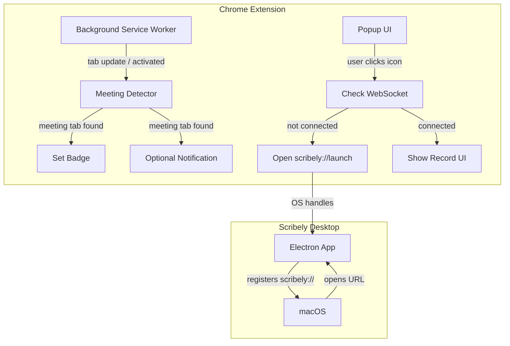

# Meeting Detection and Auto-Launch for Chrome Extension

## Current State

- **Chrome extension** ([chrome-extension/](chrome-extension/)): Shows popup with current tab info, checks WebSocket connection to Electron on port 9876, Start/Stop capture. Requires user to manually open the app first.
- **Electron app** ([desktop/](desktop/)): No custom URL scheme; cannot be launched from browser.
- **Permissions**: `tabCapture`, `offscreen`, `activeTab` — no `tabs` permission for querying all tabs.

## Architecture

## Implementation Plan

### 1. Meeting Detection (Chrome Extension)

**Add `tabs` permission** to [chrome-extension/manifest.json](chrome-extension/manifest.json) so the extension can query tab URLs.

**Create meeting URL matcher** — new file `chrome-extension/meeting-detector.js` with simplified regex patterns (based on [Recall.ai meeting URLs](https://docs.recall.ai/docs/meeting-urls)):

| Platform        | Pattern                                     |
| --------------- | ------------------------------------------- |
| Google Meet     | `meet\.google\.com/(\w{3}-\w{4}-\w{3})`     |
| Zoom            | `zoom(us                                    |
| Microsoft Teams | `teams\.microsoft\.com`, `teams\.live\.com` |
| Webex           | `webexcom/(meet                             |
| GoTo            | `(appgotocom                                |

**Background script** ([chrome-extension/background.js](chrome-extension/background.js)):

- Add `chrome.tabs.onUpdated` and `chrome.tabs.onActivated` listeners to detect when the active tab (or any tab) becomes a meeting.
- Store `meetingTabId` and `meetingTabInfo` in background state.
- Set badge (e.g. `"Rec"` or `"1"`) when a meeting tab exists; clear when none.
- Optional: `chrome.notifications` (requires `notifications` permission) to notify user when meeting detected — can be a follow-up or user preference.

### 2. Popup UI Updates

**Popup logic** ([chrome-extension/popup.js](chrome-extension/popup.js)):

- On init: query meeting tabs (use background `get-status` extended to include `meetingTabId`, or new message `get-meeting-tabs`).
- If current tab is a meeting **or** a meeting tab exists: show "Record this meeting" as primary CTA; pre-select the meeting tab for capture.
- If desktop app not connected: show "Launch Scribely" button instead of "Start Sharing" — clicking it opens `scribely://launch` via `chrome.tabs.create({ url: 'scribely://launch' })` (or `window.open`). After a short delay, re-check WebSocket and enable "Start Sharing" when connected.
- If no meeting tab: keep current behavior (record current tab, with existing "Desktop app not running" message).

**Popup HTML** ([chrome-extension/popup.html](chrome-extension/popup.html)):

- Add optional "Launch Scribely" button when app is not running.
- Adjust copy: "Record meeting" when meeting tab detected, "Start Sharing" otherwise.

### 3. Custom URL Scheme (Electron App)

**Register `scribely://` protocol** so the OS can launch the app when the extension opens `scribely://launch`:

1. **electron-builder config** ([desktop/package.json](desktop/package.json)): Add `protocols` or `extendInfo.CFBundleURLTypes` for `scribely` scheme (see [electron-builder Mac config](https://www.electron.build/configuration/mac)).
2. **Main process** ([desktop/src/main/index.ts](desktop/src/main/index.ts)):
  - Call `app.setAsDefaultProtocolClient('scribely')` (after `!process.defaultApp` check for dev).
  - Register `app.on('open-url', ...)` **before** `app.ready` to handle `scribely://launch` (and optionally `scribely://` with params). On macOS, this brings the app to front; no extra logic needed if the app already starts the WebSocket server.

### 4. Edge Cases

- **App not installed**: Opening `scribely://launch` does nothing or shows OS "no handler" dialog. Popup should show: "Scribely is not installed. [Download Scribely](link-to-download)." Use a known download URL (e.g. GitHub releases or website).
- **Multiple meeting tabs**: Popup can list them or default to the active one; simplest is to use the active tab if it's a meeting, else the first meeting tab found.
- **Permission for notifications**: Add only if we implement `chrome.notifications`; otherwise skip to avoid permission creep.

## Files to Modify

| File                                                                         | Changes                                                        |
| ---------------------------------------------------------------------------- | -------------------------------------------------------------- |
| [chrome-extension/manifest.json](chrome-extension/manifest.json)             | Add `tabs` permission                                          |
| [chrome-extension/meeting-detector.js](chrome-extension/meeting-detector.js) | **New** — URL patterns + `isMeetingUrl(url)`                   |
| [chrome-extension/background.js](chrome-extension/background.js)             | Tab listeners, meeting detection, badge, extended `get-status` |
| [chrome-extension/popup.js](chrome-extension/popup.js)                       | Meeting-aware UI, "Launch Scribely" flow, `scribely://launch`  |
| [chrome-extension/popup.html](chrome-extension/popup.html)                   | "Launch Scribely" button, conditional copy                     |
| [desktop/package.json](desktop/package.json)                                 | `build.mac.protocols` or `extendInfo.CFBundleURLTypes`         |
| [desktop/src/main/index.ts](desktop/src/main/index.ts)                       | `setAsDefaultProtocolClient`, `open-url` handler               |

## Notes

- **Chrome cannot programmatically open the popup** — the user must click the extension icon. The badge draws attention when a meeting is detected.
- `**scribely://` only works when the app is packaged** — not in `npm run dev`. Document this for testing.
- **Download URL**: Decide where to link for "Install Scribely" (e.g. `https://github.com/.../releases` or product site) and add to popup.

