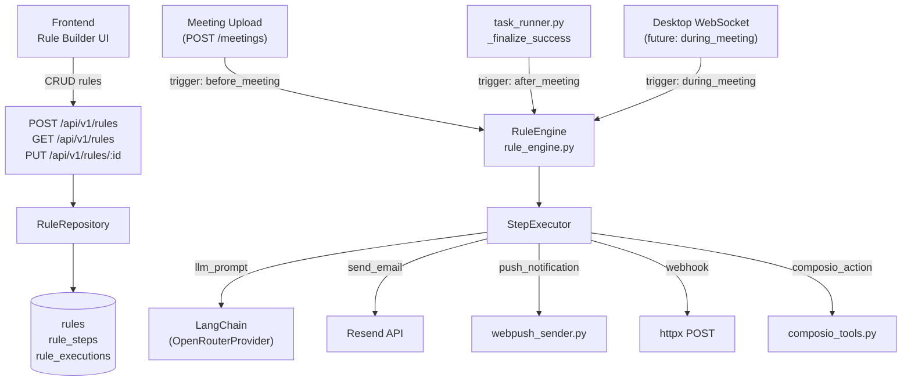

# Meeting Rules Engine

## Architecture Overview



## Data Model

Three new tables under [`backend/app/database/models/rule.py`](backend/app/database/models/rule.py):

**`rules`**
- `id`, `user_id` → `users.id`, `name`, `description`, `trigger` (`before_meeting` | `after_meeting` | `during_meeting`), `enabled` bool, `created_at`, `updated_at`

**`rule_steps`**
- `id`, `rule_id` → `rules.id` (cascade delete), `order_index` int, `name`, `step_type` enum (`llm_prompt` | `send_email` | `push_notification` | `webhook` | `composio_action`), `config` JSON

Step config shapes:
- `llm_prompt`: `{ model, system_prompt, user_prompt_template, output_variable }` — prompt templates use `{{meeting.title}}`, `{{meeting.transcript}}`, `{{steps.0.result}}` etc.
- `send_email`: `{ to_template, subject_template, body_template }`
- `push_notification`: `{ title_template, body_template }`
- `webhook`: `{ url, method, headers, body_template }`
- `composio_action`: `{ app_name, action_name, params_template }`

**`rule_executions`**
- `id`, `rule_id`, `meeting_id`, `trigger`, `status` (`pending` | `running` | `completed` | `failed`), `started_at`, `completed_at`, `step_results` JSON list, `error` text

## Backend: New Files

- [`backend/app/database/models/rule.py`](backend/app/database/models/rule.py) — SQLAlchemy models
- [`backend/app/database/repositories/rule.py`](backend/app/database/repositories/rule.py) — `RuleRepository` (CRUD + list by user + list by trigger)
- [`backend/app/services/rule_engine.py`](backend/app/services/rule_engine.py) — `RuleEngine.execute(rule, meeting, context)` with Jinja2 template rendering + sequential step executor per type
- [`backend/app/api/v1/rules.py`](backend/app/api/v1/rules.py) — REST CRUD + `POST /rules/{id}/test` + `POST /rules/prompt/optimize` (streaming LLM)
- [`backend/alembic/versions/007_rules.py`](backend/alembic/versions/007_rules.py) — Alembic migration

## Backend: Modified Files

- [`backend/app/database/models/__init__.py`](backend/app/database/models/__init__.py) — import new models
- [`backend/app/api/v1/router.py`](backend/app/api/v1/router.py) — include rules router
- [`backend/app/services/task_runner.py`](backend/app/services/task_runner.py) — call `execute_rules_for_meeting(meeting_id, "after_meeting")` in `_finalize_success`
- [`backend/app/api/v1/meetings.py`](backend/app/api/v1/meetings.py) — call `execute_rules_for_meeting(meeting_id, "before_meeting")` on upload

## Rule Engine Core Logic

```python
# rule_engine.py (pseudocode)
async def execute_rule(rule, meeting, db):
    context = build_context(meeting)  # meeting.title, .transcript, .summary, etc.
    for step in sorted(rule.steps, key=lambda s: s.order_index):
        result = await execute_step(step, context)
        context["steps"][step.order_index] = {"result": result}
    save_execution(rule, meeting, context)
```

Template rendering via **Jinja2** (already a transitive dep, or add `jinja2`). Variables available in all templates:
- `meeting.title`, `meeting.transcript`, `meeting.summary`, `meeting.duration`
- `meeting.participants` (from CalendarEvent if linked)
- `steps.N.result` (output of previous step N)

LLM steps use `OpenRouterProvider` + Langfuse callbacks per the agent-architecture rule.

## Frontend: New Files

- [`frontend/src/app/(app)/rules/page.tsx`](frontend/src/app/(app)/rules/page.tsx) — rules list page
- [`frontend/src/app/(app)/rules/new/page.tsx`](frontend/src/app/(app)/rules/new/page.tsx) — rule creation form
- [`frontend/src/app/(app)/rules/[id]/page.tsx`](frontend/src/app/(app)/rules/[id]/page.tsx) — edit rule + execution history
- [`frontend/src/components/app/rules/RuleStepBuilder.tsx`](frontend/src/components/app/rules/RuleStepBuilder.tsx) — drag-reorder step list
- [`frontend/src/components/app/rules/StepConfigForm.tsx`](frontend/src/components/app/rules/StepConfigForm.tsx) — per-type config editor
- [`frontend/src/components/app/rules/PromptOptimizerChat.tsx`](frontend/src/components/app/rules/PromptOptimizerChat.tsx) — streaming LLM chat to refine prompts

## Frontend: Modified Files

- [`frontend/src/lib/api.ts`](frontend/src/lib/api.ts) — add `rules` API methods + types (`Rule`, `RuleStep`, `RuleExecution`)
- [`frontend/src/components/app/workspace/WorkspaceShell.tsx`](frontend/src/components/app/workspace/WorkspaceShell.tsx) (or nav file) — add "Rules" nav item with Workflow icon
