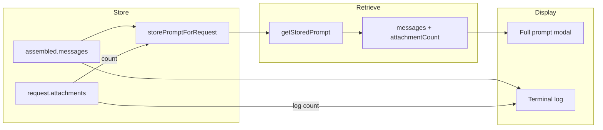

# Multiple Screenshots and Prompt Transparency

## 1. Multiple Screenshots

The backend already supports multiple image attachments (`ChatAttachment[]`). Only the UI state and components need to change.

### State and handlers

**Overlay.tsx**

- Change `pendingScreenshot: string | null` to `pendingScreenshots: string[]`
- `handleScreenshot`: append with `setPendingScreenshots(prev => [...prev, dataUrl])`
- `onScreenshotTaken` (hotkey): same append logic
- `handleSend`: clear all with `setPendingScreenshots([])` after send
- Add `handleRemoveScreenshot(index: number)` to remove by index
- Update `ActionChips` callback to build attachments from `pendingScreenshots`

### InputBar and CompactChatView

**InputBar.tsx**

- Props: `pendingScreenshots: string[]`, `onRemoveScreenshot: (index: number) => void`
- Replace single thumbnail with `pendingScreenshots.map((dataUrl, idx) => ...)` — each thumbnail has its own remove button
- `handleSubmit`: build `attachments` from all items: `pendingScreenshots.map((data, i) => ({ type: 'image', data, label: \`Screenshot ${i + 1} }))`
- Screenshot button `active` state: `pendingScreenshots.length > 0`

**CompactChatView.tsx**

- Same prop changes: `pendingScreenshots`, `onRemoveScreenshot`
- Update `handleActionClick` to use `pendingScreenshots` array
- Pass through to InputBar

### Files to modify


| File                                                                                                               | Changes                       |
| ------------------------------------------------------------------------------------------------------------------ | ----------------------------- |
| [desktop/src/renderer/src/components/Overlay.tsx](desktop/src/renderer/src/components/Overlay.tsx)                 | State, handlers, prop wiring  |
| [desktop/src/renderer/src/components/InputBar.tsx](desktop/src/renderer/src/components/InputBar.tsx)               | Multi-thumbnail UI, new props |
| [desktop/src/renderer/src/components/CompactChatView.tsx](desktop/src/renderer/src/components/CompactChatView.tsx) | Props, action handler         |


No changes to: `screenshot.ts`, `hotkey.ts`, IPC, or `llm-service.ts`.

---

## 2. Prompt Modal and Logging: Include Image Attachments

Currently the stored prompt and terminal log show only text. Images are added later in `buildApiMessagesWithImages` and never appear in logs or the modal.

### Main process (llm-service.ts)

**Store attachments with the prompt**

- Extend `storedPrompts` to store `{ messages, attachments? }` instead of just `messages`
- In `processRequest`, after assembling: `this.storePromptForRequest(request.requestId, assembled.messages, request.attachments)`
- Update `storePromptForRequest(requestId, messages, attachments?)` and `getStoredPrompt(requestId)` to return `{ messages, attachments }`

**Terminal logging**

- After `log.info('[llm] Full prompt:', ...)`, add:

```ts
  if (request.attachments?.length) {
    const imgCount = request.attachments.filter(a => a.type === 'image').length
    log.info(`[llm] User message includes ${imgCount} image attachment(s)`)
  }
  

```

### IPC and types

**preload/index.ts** and **renderer types**

- `llmGetPromptForRequest` return type: `Array<{ role: string; content: string }> | null` becomes `{ messages: Array<...>, attachments?: Array<{ type: string; label?: string }> } | null` (no need to pass full base64 for modal — we can show thumbnails from `attachments` if we store them, or just count)

**Simpler approach**: Store only attachment metadata (count, labels) to avoid huge payloads. Return shape:

```ts
{ messages: Array<{ role: string; content: string }>, attachmentCount?: number }
```

Then the modal can show `[1 image attached]` or `[3 images attached]` for the last user message without storing base64.

**Even simpler**: Store `attachmentCount` only. Modal shows "Last user message had N image(s) attached" below the text. No need to change IPC return shape if we add an optional `attachmentCount` field.

### Renderer (ResponseCard.tsx)

**Prompt modal**

- When `promptModal` includes `attachmentCount` (or `attachments`), for the last user message block, add a line: `[N image(s) attached]` or render small thumbnails if we store them.
- Update the type: `promptModal: { requestId, messages, attachmentCount?: number } | null`
- `llmGetPromptForRequest` needs to return this. So we change the IPC handler to return `{ messages, attachmentCount }` and the preload/renderer to pass it through.

### Recommended approach for attachments in modal

- Store `attachmentCount` per request (number of image attachments)
- `getStoredPrompt` returns `{ messages, attachmentCount?: number }`
- Modal: after the last user message content, if `attachmentCount > 0`, show: `[${attachmentCount} image(s) attached — sent to model]`
- This avoids storing base64, keeps the modal fast, and makes it clear images were sent.

### Files to modify


| File                                                                                                         | Changes                                                     |
| ------------------------------------------------------------------------------------------------------------ | ----------------------------------------------------------- |
| [desktop/src/main/llm/llm-service.ts](desktop/src/main/llm/llm-service.ts)                                   | Store/return attachmentCount, add log line                  |
| [desktop/src/preload/index.ts](desktop/src/preload/index.ts)                                                 | Update `llmGetPromptForRequest` return type if needed       |
| [desktop/src/renderer/src/types/index.ts](desktop/src/renderer/src/types/index.ts)                           | Update `llmGetPromptForRequest` in ElectronAPI              |
| [desktop/src/renderer/src/components/ResponseCard.tsx](desktop/src/renderer/src/components/ResponseCard.tsx) | Handle new return shape, show attachment indicator in modal |


---

## Data flow (multiple screenshots)

```mermaid
flowchart LR
  subgraph capture [Capture]
    Hotkey[Hotkey / Button]
    Screenshot[screenshot.ts]
  end
  subgraph state [State]
    Pending[pendingScreenshots: string[]]
  end
  subgraph ui [UI]
    Thumbnails[Thumbnail grid + remove]
    InputBar[InputBar]
  end
  subgraph send [Send]
    Attachments[ChatAttachment[]]
    LLM[LLM Service]
  end
  Hotkey --> Screenshot
  Screenshot -->|append| Pending
  Pending --> Thumbnails
  Thumbnails -->|remove by index| Pending
  InputBar -->|onSend| Attachments
  Pending -->|map to attachments| Attachments
  Attachments --> LLM
```


## Data flow (prompt transparency)




