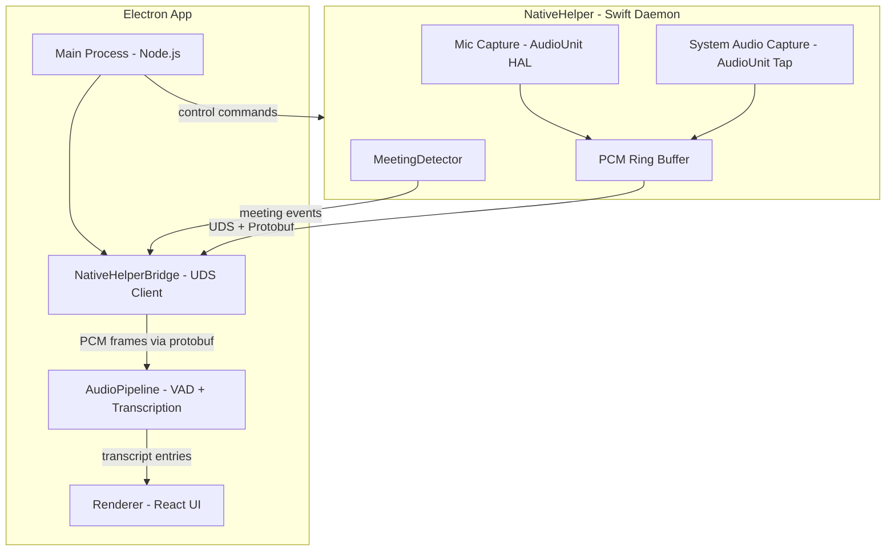

# Native Audio Capture Helper (NativeHelper v1)

## Architecture




## Current Bug (for context)

The recording saves video without audio because `useMeetingRecorder.ts` uses `MediaRecorder` on a combined stream, but the audio tracks from `getDisplayMedia` may not have live audio (macOS window capture often lacks system audio). The native approach eliminates this entirely by capturing audio at the CoreAudio level.

## File Structure

New files to create:

```
desktop/
  native/                              # Swift package for NativeHelper
    Package.swift                      # Swift Package Manager manifest
    Sources/
      NativeHelper/
        main.swift                     # Entry point, LaunchAgent setup
        AudioCaptureEngine.swift       # CoreAudio mic + system capture
        IPCServer.swift                # UDS server, protobuf serialization
        MeetingDetector.swift          # App/window/mic detection (stub for v1)
        Config.swift                   # Constants, paths, settings
    Proto/
      messages.proto                   # Protobuf message definitions
  src/
    main/
      native-bridge.ts                # UDS client, protobuf deserialization
      audio/
        pipeline.ts                    # Modified: accept frames from native bridge
    preload/
      index.ts                         # Modified: add native status IPC
    renderer/src/
      hooks/
        useAudioCapture.ts             # Modified: delegate to native helper
      components/
        Overlay.tsx                     # Modified: native helper status
```

## Phase 1: Protocol Buffers Schema

File: `desktop/native/Proto/messages.proto`

Define the IPC contract between NativeHelper and Electron:

```protobuf
syntax = "proto3";
package assistme;

// Control messages (Electron -> NativeHelper)
message ControlMessage {
  oneof command {
    StartCapture start_capture = 1;
    StopCapture stop_capture = 2;
    PauseCapture pause_capture = 3;
    ResumeCapture resume_capture = 4;
    GetStatus get_status = 5;
  }
}

message StartCapture {
  bool capture_mic = 1;
  bool capture_system = 2;
}
message StopCapture {}
message PauseCapture {}
message ResumeCapture {}
message GetStatus {}

// Data messages (NativeHelper -> Electron)
message NativeMessage {
  oneof payload {
    AudioFrame audio_frame = 1;
    StatusUpdate status = 2;
    MeetingEvent meeting_event = 3;
    MetricsUpdate metrics = 4;
    ErrorEvent error = 5;
  }
}

message AudioFrame {
  string source = 1;        // "mic" or "system"
  bytes pcm_data = 2;       // Float32 PCM samples as raw bytes
  uint32 sample_rate = 3;
  uint64 timestamp_ms = 4;
  uint32 num_samples = 5;
}

message StatusUpdate {
  string state = 1;          // "idle", "capturing", "paused", "error"
  bool mic_active = 2;
  bool system_audio_active = 3;
}

message MeetingEvent {
  string event_type = 1;     // "MEETING_DETECTED", "MEETING_ENDED"
  float confidence = 2;
  string source_app = 3;
}

message MetricsUpdate {
  float cpu_percent = 1;
  uint64 memory_bytes = 2;
  uint32 dropped_frames = 3;
}

message ErrorEvent {
  string code = 1;
  string message = 2;
}
```

## Phase 2: Swift NativeHelper Daemon

### `Package.swift`

Swift Package Manager project with dependencies:

- `swift-protobuf` for protobuf serialization
- `swift-nio` for UDS server (or raw POSIX sockets for simplicity)

### `AudioCaptureEngine.swift`

Core audio capture using `AudioUnit` framework:

- **Mic capture**: `kAudioUnitSubType_HALOutput` AudioUnit configured for the default input device. Uses an input callback (`kAudioUnitProperty_SetRenderCallback`) to receive PCM buffers.
- **System audio capture**: Uses `AudioObjectAddPropertyListener` on the default output device + an aggregate device or screen capture audio tap (macOS 14+ `SCStream` audio-only, or the `kAudioUnitSubType_HALOutput` with a loopback aggregate device).
- Both streams output 48kHz stereo (system) / 16kHz mono (mic) PCM Float32.
- Chunk size: 5 seconds of audio per protobuf message (configurable).
- Separate threads for IO and encoding.

Key macOS APIs:

- `AudioComponentFindNext` / `AudioComponentInstanceNew`
- `AudioUnitSetProperty` with `kAudioUnitProperty_StreamFormat`
- `AudioOutputUnitStart` / `AudioOutputUnitStop`
- `AudioObjectGetPropertyData` for device enumeration

### `IPCServer.swift`

Unix Domain Socket server:

- Listens on `~/Library/Application Support/AssistMe/assistme.sock`
- Length-prefixed protobuf messages (4-byte big-endian length prefix + serialized bytes)
- Bidirectional: receives `ControlMessage`, sends `NativeMessage`
- Handles client disconnect/reconnect gracefully
- Single client at a time (Electron main process)

### `main.swift`

- Parse CLI args (socket path, log level)
- Initialize `AudioCaptureEngine`
- Initialize `IPCServer`
- Wire audio callbacks to IPC: when audio buffer is ready, serialize as `AudioFrame` protobuf and send over UDS
- Run the main RunLoop
- Signal handling (SIGTERM, SIGINT) for clean shutdown
- LaunchAgent plist generation for auto-start

### `MeetingDetector.swift` (stub for v1)

- Placeholder that emits `MeetingEvent` when `StartCapture` is received
- Full implementation (NSWorkspace notifications, AXUIElement, process scanning) deferred to Phase 2

## Phase 3: Electron Native Bridge

### `desktop/src/main/native-bridge.ts`

New module that manages the NativeHelper process and UDS connection:

```typescript
class NativeHelperBridge extends EventEmitter {
  private socket: net.Socket | null = null
  private childProcess: ChildProcess | null = null
  private socketPath: string

  // Lifecycle
  async start(): Promise<void>     // Spawn NativeHelper, connect UDS
  async stop(): Promise<void>      // Send stop, disconnect, kill process

  // Control
  async startCapture(options: { mic: boolean; system: boolean }): Promise<void>
  async stopCapture(): Promise<void>
  async pauseCapture(): Promise<void>
  async resumeCapture(): Promise<void>

  // Events emitted:
  // 'audio-frame' -> { source, pcm: Float32Array, sampleRate, timestamp }
  // 'status' -> { state, micActive, systemAudioActive }
  // 'meeting-event' -> { eventType, confidence, sourceApp }
  // 'error' -> { code, message }
}
```

Key implementation details:

- Uses `child_process.spawn()` to launch the NativeHelper binary
- Connects to UDS at `~/Library/Application Support/AssistMe/assistme.sock`
- Reads length-prefixed protobuf messages from the socket
- Deserializes `NativeMessage` and emits typed events
- Serializes `ControlMessage` for outbound commands
- Handles reconnection if NativeHelper restarts
- Uses `protobufjs` npm package for protobuf parsing

### Modifications to `desktop/src/main/audio/pipeline.ts`

The `AudioPipeline` class needs a new input path:

- Add `setNativeBridge(bridge: NativeHelperBridge)` method
- Listen for `'audio-frame'` events from the bridge
- Route native audio frames through the same VAD + transcription pipeline
- The existing `meeting:audio-frame` IPC handler remains as fallback (renderer-based capture)
- Add `meeting:start-native-capture` / `meeting:stop-native-capture` IPC handlers

### Modifications to `desktop/src/main/index.ts`

- Import and instantiate `NativeHelperBridge`
- Start the bridge on app ready (spawn NativeHelper)
- Connect bridge to `AudioPipeline`
- Stop bridge on app quit
- Add IPC handlers for native capture control from renderer

### Modifications to `desktop/src/preload/index.ts`

Add new IPC methods:

- `startNativeCapture(options)` / `stopNativeCapture()`
- `onNativeStatus(callback)` / `getNativeStatus()`

### Modifications to renderer hooks

`useAudioCapture.ts`:

- Add a `useNativeCapture` mode that delegates to the native bridge instead of `getDisplayMedia`/`getUserMedia`
- Fall back to browser-based capture if native helper is unavailable

`Overlay.tsx`:

- Show native helper status (connected/disconnected)
- Use native capture path when available

## Phase 4: Build Integration

- Add a build script that compiles the Swift package (`swift build -c release`)
- Copy the binary to `desktop/resources/` for Electron packaging
- Generate the LaunchAgent plist for auto-start
- Add the protobuf compilation step (`protoc` for `.proto` -> Swift + TypeScript)

## Dependencies to Add

**npm (desktop/package.json):**

- `protobufjs` - Protocol Buffers for Node.js (parse .proto files, serialize/deserialize)

**Swift (Package.swift):**

- `apple/swift-protobuf` - Protocol Buffers for Swift
- Standard macOS frameworks: `CoreAudio`, `AudioToolbox`, `Foundation`

## Key Risks and Mitigations

1. **CoreAudio system audio capture requires an aggregate device or audio tap** - On macOS 14+, `SCStream` can capture system audio without a virtual device. On older macOS, may need a signed audio driver (BlackHole-style). Start with macOS 14+ only.
2. **LaunchAgent permissions** - The NativeHelper needs microphone permission separately from Electron. Handle via `Info.plist` usage descriptions and runtime permission checks.
3. **Protobuf overhead for audio** - Sending raw PCM over protobuf adds serialization cost. Use `bytes` field type (zero-copy in protobuf) and chunk at 5s intervals to amortize overhead.
4. **Binary distribution** - The Swift binary must be code-signed and notarized alongside the Electron app. Add to the electron-builder config.

