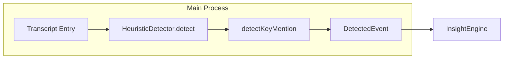

# Replace Regex Key Mention Detection with Lightweight NER (compromise)

## Current State

The `detectKeyMention` function in [heuristic-detector.ts](desktop/src/main/insights/heuristic-detector.ts) uses four regex patterns:

- **DOLLAR_AMOUNT** — `$1.5M`, `$2,000`, etc.
- **DATE_PATTERN** — `Jan 15, 2024`, `01/15/24`, `2024-01-15`
- **URL_PATTERN** — `https://...`
- **CAPITALIZED_ENTITY** — `John Smith`, `Acme Corp` (capitalized multi-word phrases)

These are brittle: they miss many formats (e.g. "five million dollars", "next Tuesday", "Q1 2025") and the capitalized-entity regex is a crude heuristic.

## Recommended Approach: compromise

**compromise** is the best fit for this Electron app:


| Criterion      | compromise                         | spaCy                  | wink-nlp                |
| -------------- | ---------------------------------- | ---------------------- | ----------------------- |
| Size           | ~250KB minified                    | 100MB+ models          | ~10KB core + ~3MB model |
| Model download | None                               | Required               | Required                |
| Runtime        | Pure JS, sync                      | Python bridge or heavy | Async model load        |
| Entity types   | money, dates, people, places, orgs | Full NER               | Full NER                |
| Maintenance    | Active, 12k+ stars                 | N/A (Python)           | Active                  |


**Why not spaCy:** Would require a Python runtime and a bridge (child_process, python-shell), complicating deployment and breaking the "zero-cost" sync design.

**Why not wink-nlp:** Requires a separate ~3MB language model download; adds async initialization. Heavier than needed.

## Implementation Plan

### 1. Add dependency

```bash
npm install compromise
```

Optional for richer date parsing (relative dates, quarters, etc.):

```bash
npm install compromise-dates
```

### 2. Refactor `detectKeyMention` in [heuristic-detector.ts](desktop/src/main/insights/heuristic-detector.ts)

- **Remove** the four regex constants (lines 117–121).
- **Import** compromise (and optionally compromise-dates).
- **Rewrite** `detectKeyMention` to:
  - Call `nlp(text)` once per entry.
  - Use `.money()` → `metadata.amount` (first match `.text()`).
  - Use `.dates()` → `metadata.date` (first match; richer with compromise-dates).
  - Use `.people()`, `.places()`, `.organizations()` → merge into `metadata.entity` or separate `metadata.person`, `metadata.place`, `metadata.organization` (pick one schema and document it).
  - **Keep** URL regex — compromise does not expose `.urls()` in core; the regex is simple and reliable.
- Preserve the existing `DetectedEvent` shape and `metadata` structure so downstream consumers (InsightEngine, LiveInsightsPanel) do not need changes.

### 3. Metadata schema decision

Current schema uses a single `entity` for capitalized phrases. With compromise we get typed entities:

- **Option A (minimal change):** Keep `metadata.entity` as the first person/place/org found (backward compatible).
- **Option B (richer):** Add `metadata.person`, `metadata.place`, `metadata.organization` as arrays; keep `entity` for the first non-empty for backward compatibility.

Recommend **Option A** for simplicity unless the UI needs typed display.

### 4. Performance and bundling

- compromise is sync and fast; the heuristic detector already runs per-entry in the main process.
- compromise is pure JS; it will bundle with the main process via electron-vite. No externals needed.
- No changes to [electron.vite.config.ts](desktop/electron.vite.config.ts).

### 5. Testing

- Run `npm run typecheck` after changes.
- Manually test with sample transcript entries containing: `$2.5M`, `next Tuesday`, `John Smith`, `https://example.com`, `Acme Corporation`.

## Data Flow (unchanged)




The `DetectedEvent` interface and `metadata` shape remain compatible; only the extraction logic inside `detectKeyMention` changes.

## Files to Modify

- [desktop/package.json](desktop/package.json) — add `compromise` (and optionally `compromise-dates`)
- [desktop/src/main/insights/heuristic-detector.ts](desktop/src/main/insights/heuristic-detector.ts) — replace regex-based `detectKeyMention` with compromise-based implementation

