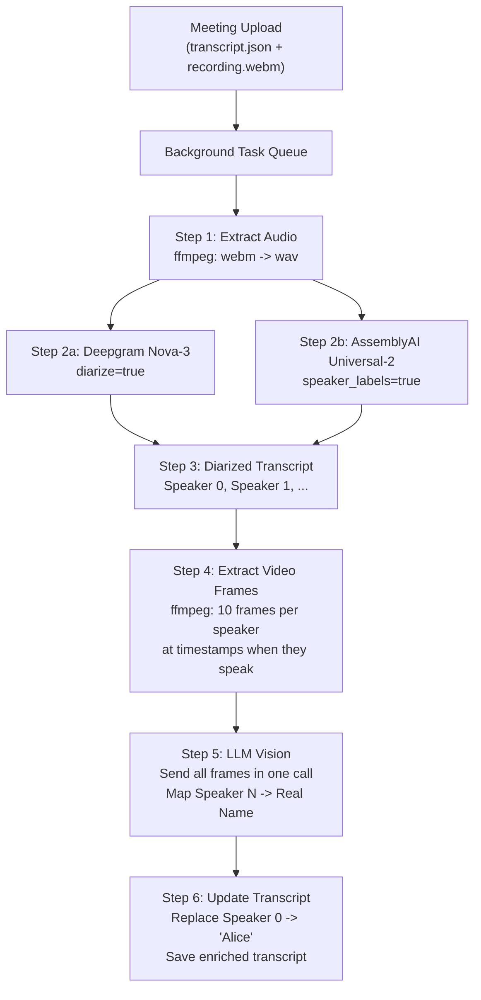

# Speaker Attribution via Diarization + LLM Vision

## Current State

- Audio is transcribed locally via Whisper (chunk-based, no diarization)
- Speaker attribution is binary: `source === 'mic'` -> "You", `source === 'system'` -> "Them"
- Meetings are uploaded to backend as `transcript.json` + `recording.webm` via `POST /api/v1/meetings/`
- No post-processing pipeline exists on the backend
- Recordings are WebM (VP9+Opus, ~2.5 Mbps) stored at `{UPLOAD_DIR}/{user_id}/{meeting_id}/recording.webm`

## Architecture Overview

Post-meeting processing pipeline triggered after meeting upload:




## Step-by-Step Implementation

### 1. Backend Config + Dependencies

Add to [backend/app/config.py](backend/app/config.py):

- `deepgram_api_key: str`
- `assemblyai_api_key: str`
- `diarization_provider: str` (either `"deepgram"` or `"assemblyai"`)
- `openai_api_key: str` (for LLM vision calls)

Add Python dependencies: `deepgram-sdk`, `assemblyai`, `openai`, `ffmpeg-python` (or just shell out to `ffmpeg`)

### 2. Audio Extraction Service

New file: `backend/app/services/audio_extractor.py`

- `extract_audio(webm_path: Path) -> Path` — runs `ffmpeg -i recording.webm -vn -ar 16000 -ac 1 audio.wav`
- Returns path to extracted WAV (16kHz mono, ideal for both providers)
- Stored alongside the recording in the meeting directory

### 3. Diarization Service (Provider-Agnostic)

New file: `backend/app/services/diarization.py`

**Interface:**

```python
@dataclass
class DiarizedUtterance:
    speaker: str        # "Speaker 0", "Speaker 1", etc.
    text: str
    start_ms: int
    end_ms: int
    confidence: float

async def diarize(audio_path: Path, provider: str) -> list[DiarizedUtterance]
```

**Deepgram Nova-3 implementation:**

- `POST https://api.deepgram.com/v1/listen?model=nova-3&diarize=true&punctuate=true&utterances=true`
- Upload the WAV file directly
- Parse `results.utterances` — each has `speaker`, `start`, `end`, `transcript`

**AssemblyAI Universal-2 implementation:**

- Use `assemblyai` SDK: `TranscriptionConfig(speaker_labels=True)`
- Upload audio file, poll for completion
- Parse `transcript.utterances` — each has `speaker`, `text`, `start`, `end`

Both normalize output to `list[DiarizedUtterance]` with consistent speaker labels (`Speaker 0`, `Speaker 1`, ...).

### 4. Frame Extraction Service

New file: `backend/app/services/frame_extractor.py`

- `extract_speaker_frames(webm_path: Path, utterances: list[DiarizedUtterance], frames_per_speaker: int = 10) -> dict[str, list[Path]]`
- For each unique speaker, pick ~10 utterances spread evenly across the meeting (to get diverse screenshots)
- For each selected utterance, extract a frame at `start_ms + (end_ms - start_ms) / 2` (midpoint of their speech)
- Use `ffmpeg -ss {timestamp} -i recording.webm -frames:v 1 -q:v 2 frame.jpg`
- Returns `{ "Speaker 0": [frame1.jpg, frame2.jpg, ...], "Speaker 1": [...] }`
- Frames stored in `{meeting_dir}/frames/` (temporary, cleaned up after processing)

### 5. LLM Vision Speaker Identification

New file: `backend/app/services/speaker_identifier.py`

- `identify_speakers(speaker_frames: dict[str, list[Path]], utterances: list[DiarizedUtterance]) -> dict[str, str]`
- Makes a **single** OpenAI GPT-4o/GPT-5 vision API call with all frames for all speakers
- Constructs a prompt like:

```
You are analyzing a video meeting to identify speakers. I have a transcript with 
multiple speakers labeled as "Speaker 0", "Speaker 1", etc.

For each speaker, I'm providing screenshots taken at moments when they were speaking.
In most video conferencing tools, the active speaker is highlighted or enlarged.

[Speaker 0 frames: 10 images]
[Speaker 1 frames: 10 images]
...

Based on the visual cues (name labels in the meeting UI, speaker highlighting, 
participant panels), identify the real name for each speaker.

Also use transcript context — here are sample utterances per speaker:
- Speaker 0: "Hi everyone, I'm Alice from engineering..."
- Speaker 1: "Thanks Alice, let me share the Q2 numbers..."

Return a JSON mapping: { "Speaker 0": "Alice Chen", "Speaker 1": "Bob Smith", ... }
```

- Include a few representative utterances per speaker in the prompt (helps when names are mentioned verbally)
- Falls back to generic labels if the LLM can't identify a speaker

### 6. Post-Processing Orchestrator

New file: `backend/app/services/meeting_processor.py`

- `process_meeting(meeting_dir: Path, provider: str) -> dict`
- Orchestrates the full pipeline: extract audio -> diarize -> extract frames -> identify speakers -> update transcript
- Saves enriched transcript as `transcript_enriched.json` in the meeting directory (preserves original)
- Enriched transcript format adds `diarization` section:

```json
{
  "version": 2,
  "createdAt": "...",
  "diarization": {
    "provider": "deepgram",
    "speakerMap": { "Speaker 0": "Alice Chen", "Speaker 1": "Bob Smith" },
    "processedAt": "...",
    "utterances": [
      { "speaker": "Alice Chen", "text": "...", "startMs": 0, "endMs": 3200 }
    ]
  },
  "entries": [ ... ]  // original entries preserved
}
```

### 7. API Endpoint + Background Processing

Modify [backend/app/api/v1/meetings.py](backend/app/api/v1/meetings.py):

- After saving files in `sync_meeting`, kick off background processing via `asyncio.create_task` (or a simple task queue)
- Add new endpoint: `GET /api/v1/meetings/{meeting_id}/status` — returns processing status
- Add new endpoint: `GET /api/v1/meetings/{meeting_id}/transcript` — returns enriched transcript if available, else original

New file: `backend/app/services/task_runner.py`

- Simple async background task runner (no Celery needed for now)
- Tracks task status per meeting: `pending` -> `processing` -> `completed` / `failed`
- Stores status in a JSON file in the meeting directory: `processing_status.json`

### 8. System Dependency: ffmpeg

The backend needs `ffmpeg` installed for audio extraction and frame capture. Add a note in the backend README and optionally a health check that verifies `ffmpeg` is available.

## Key Design Decisions

- **Post-meeting only** (per user preference) — no real-time diarization complexity
- **Both providers supported** — configurable via `DIARIZATION_PROVIDER` env var, easy A/B comparison
- **Single LLM vision call** for all speakers — cost-efficient, lets the model cross-reference and disambiguate
- **Original transcript preserved** — enriched version saved separately as `transcript_enriched.json`
- **No DB model for meetings yet** — continues file-based storage pattern; DB model can be added later
- **ffmpeg for frame extraction** — reliable, handles WebM well, no Python video decoding needed
- **Background processing** — doesn't block the upload response; status trackable via API

## Files to Create/Modify


| File                                         | Action                                                |
| -------------------------------------------- | ----------------------------------------------------- |
| `backend/app/config.py`                      | Add API keys + diarization config                     |
| `backend/app/services/audio_extractor.py`    | New — ffmpeg audio extraction                         |
| `backend/app/services/diarization.py`        | New — Deepgram + AssemblyAI diarization               |
| `backend/app/services/frame_extractor.py`    | New — ffmpeg video frame extraction                   |
| `backend/app/services/speaker_identifier.py` | New — LLM vision speaker mapping                      |
| `backend/app/services/meeting_processor.py`  | New — orchestrator                                    |
| `backend/app/services/task_runner.py`        | New — background task management                      |
| `backend/app/api/v1/meetings.py`             | Add status + transcript endpoints, trigger processing |
| `backend/app/api/v1/router.py`               | Wire new endpoints                                    |
| `backend/pyproject.toml`                     | Add dependencies                                      |
| `backend/.env.example`                       | Add new env vars                                      |


