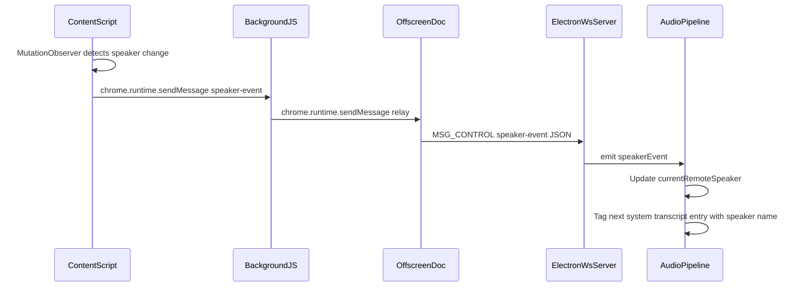

# Speaker Attribution via DOM Observation

## Problem

All remote audio is currently labeled `"Them"` because the pipeline only distinguishes `mic` (You) vs `system` (Them). There is no mechanism to identify which remote participant is speaking.

## Approach

Use the Chrome extension's content script -- which already runs on meeting pages -- to observe the DOM for participant names and active speaker indicators. Relay these events to Electron over the existing WebSocket. Correlate with transcript entries by timestamp to replace `"Them"` with real names like `"Dan Melanson"`.

## Data Flow




## Phase 1: Google Meet DOM Speaker Observer (content script)

File: [chrome-extension/content-script.js](chrome-extension/content-script.js)

The content script already runs on `meet.google.com/*` (declared in [manifest.json](chrome-extension/manifest.json) `content_scripts`). Currently it only renders a floating widget. We add a speaker observer module alongside it.

**What to detect from the Google Meet DOM:**

- **Participant tiles**: `div.tTdl5d.MSqqjf` -- each participant has one
- **Participant name**: extracted from tile text content (`"Plus d'options pour {name}"` / `"More options for {name}"`)
- **Active speaker class**: `qs41qe` (or a similar toggling class) on the tile, plus potential child border elements
- **Fallback**: the large/pinned tile in speaker view indicates the active speaker

**Observer logic:**

1. On page load (after meeting joins), scan for participant tiles
2. Set up a `MutationObserver` on the tile container watching for `attributes` (class changes) and `childList` (tiles added/removed)
3. When a tile gains the active-speaker indicator, extract the name and send:

```javascript
chrome.runtime.sendMessage({
  type: 'speaker-event',
  name: 'Dan Melanson',
  speaking: true,
  timestamp: Date.now()
})
```

1. Re-scan participants periodically (people join/leave)
2. Use structural selectors as primary (e.g., "div containing 'More options for'") with class-based selectors as acceleration -- this makes the system more resilient to class name changes across Google deploys

**New file**: `chrome-extension/speaker-observer.js` -- provider-specific module, imported by the content script. Encapsulates all Google Meet DOM knowledge.

## Phase 2: Relay Through Extension to Electron

### Background script ([chrome-extension/background.js](chrome-extension/background.js))

Add a new message handler:

```javascript
case 'speaker-event':
  // Forward to offscreen document for WS relay
  chrome.runtime.sendMessage({
    type: 'relay-speaker-event',
    name: message.name,
    speaking: message.speaking,
    timestamp: message.timestamp
  })
  return false
```

### Offscreen document ([chrome-extension/offscreen.js](chrome-extension/offscreen.js))

Listen for `relay-speaker-event` messages and send them as `MSG_CONTROL` over the existing WebSocket:

```javascript
sendControl(ws, {
  type: 'speaker-event',
  name: message.name,
  speaking: message.speaking,
  timestamp: message.timestamp
})
```

No new message types needed -- this reuses the existing `MSG_CONTROL` (0x03) JSON channel.

## Phase 3: Electron WebSocket Server Handling

### WsServer ([desktop/src/main/ws-server.ts](desktop/src/main/ws-server.ts))

In `_handleControl`, add handling for the new `speaker-event` control message:

```typescript
if (msg.type === 'speaker-event' && ws === this.captureClient) {
  this.emit('speakerEvent', {
    name: msg.name as string,
    speaking: msg.speaking as boolean,
    timestamp: msg.timestamp as number,
  })
}
```

### Index wiring ([desktop/src/main/index.ts](desktop/src/main/index.ts))

Wire the new event to the pipeline, alongside the existing `audioFrame` / `videoChunk` listeners (~line 692):

```typescript
extensionWsServer.on('speakerEvent', (event) => {
  audioPipeline.handleSpeakerEvent(event)
})
```

## Phase 4: Pipeline Speaker Correlation

### AudioPipeline ([desktop/src/main/audio/pipeline.ts](desktop/src/main/audio/pipeline.ts))

Add state tracking and correlation:

**New state:**

- `currentRemoteSpeaker: { name: string, since: number } | null`
- `speakerTimeline: Array<{ name: string, startMs: number, endMs: number }>` -- rolling window of recent speaker events

**New method `handleSpeakerEvent`:**

- Updates `currentRemoteSpeaker` when `speaking: true`
- Appends to `speakerTimeline` with timestamp
- Clears when `speaking: false` (optional -- may just let next event override)

**Modify transcript entry creation** (two places -- `_transcribeSegment` ~line 429 and `_drainTranscribeQueue` ~line 519):

Currently:

```typescript
speaker: item.source === 'mic' ? 'You' : 'Them',
```

Change to:

```typescript
speaker: item.source === 'mic' ? 'You' : this._resolveRemoteSpeaker(item.timestamp),
```

**New method `_resolveRemoteSpeaker(timestamp: number): string`:**

- Look at `speakerTimeline` entries overlapping the transcript segment's time window
- If a single speaker dominated, return their name
- If ambiguous or no data, return `'Them'` (safe fallback)
- Never assign a name with low confidence

**Also emit speaker to renderer** so the live transcript panel can show real names in real-time. The existing `meeting:transcript-entry` IPC already carries the `speaker` field, so this works automatically.

## Phase 5: Validation and Resilience

- **Selector health check**: if the content script finds zero participant tiles after the meeting is clearly joined (e.g., 30s after page load), log a warning. This detects when Google changes their DOM structure.
- **Provider detection**: use URL to pick the right observer module. Only Google Meet for MVP; Zoom/Teams adapters added later with the same interface.
- **Class name resilience**: prefer structural selectors (parent-child relationships, text content patterns like "More options for") over exact class names. Use class names only as a fast-path hint.
- **Graceful degradation**: if the observer finds no speaking indicators, all entries stay as `"Them"` -- the system is no worse than today.

## Files Changed (Summary)


| File                                   | Change                                                                  |
| -------------------------------------- | ----------------------------------------------------------------------- |
| `chrome-extension/speaker-observer.js` | **NEW** -- Google Meet DOM observer module                              |
| `chrome-extension/content-script.js`   | Import and start speaker observer alongside existing widget             |
| `chrome-extension/background.js`       | Relay `speaker-event` messages to offscreen                             |
| `chrome-extension/offscreen.js`        | Forward `relay-speaker-event` as `MSG_CONTROL` over WebSocket           |
| `desktop/src/main/ws-server.ts`        | Parse `speaker-event` control messages, emit `speakerEvent`             |
| `desktop/src/main/index.ts`            | Wire `speakerEvent` to pipeline                                         |
| `desktop/src/main/audio/pipeline.ts`   | Add speaker timeline, `handleSpeakerEvent()`, `_resolveRemoteSpeaker()` |


## Out of Scope (for later)

- Zoom / Teams / Webex adapters (same interface, different DOM selectors)
- Audio diarization fallback for non-extension recordings
- Post-processing enrichment on backend (re-attribute speakers from saved recordings)
- Speaker color assignment in the renderer UI
- Confidence scoring beyond binary (has data / no data)

