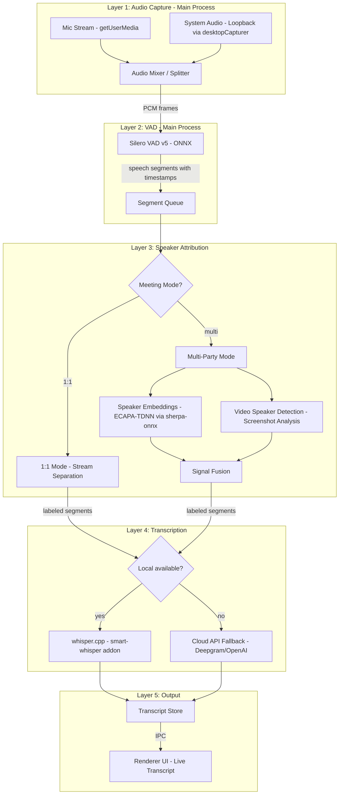
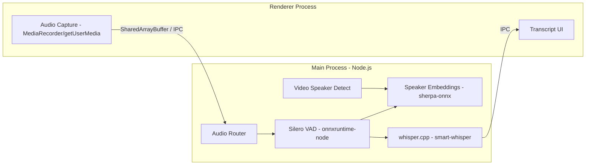

# Real-Time STT + Speaker Attribution Pipeline

## Current State Assessment

The existing implementation in `[useWhisperSTT.ts](desktop/src/renderer/src/hooks/useWhisperSTT.ts)` is minimal:

- Records mic-only via `getUserMedia({ audio: true })`
- Sends 3-second WebM chunks to OpenAI Whisper API (`whisper-1`)
- No system audio capture, no speaker attribution, no diarization
- ~3-4 second latency per chunk (recording + API round-trip)
- Runs entirely in the renderer process

This needs to be replaced with a multi-layer pipeline.

---

## Proposed Architecture




---

## Layer 1: Audio Capture

### Design Decisions (from user input)

- **Platform**: macOS first, keep Windows compatibility in mind for architecture
- **Processing**: All in Electron (no backend dependency, works offline)
- **Transcription**: Local-first (whisper.cpp + sherpa-onnx), cloud as fallback only
- **Video detection**: Google Meet only (for now)
- **Meeting mode**: Both 1:1 and multi-party equally important

### Dual-Stream Architecture

The key insight: keep mic and tab/window audio as **separate streams** for as long as possible. This gives us free speaker attribution in 1:1 mode and cleaner audio for transcription.

**Microphone Stream:**

- Captured via `getUserMedia({ audio: true })` in the renderer (existing approach)
- Always represents the local user
- Forward raw PCM to main process via IPC SharedArrayBuffer

**Tab/Window Audio Stream:**

Use `getDisplayMedia()` to let the user pick a specific browser tab (e.g., Google Meet) or application window. This captures **only that source's audio** -- not all system audio.

In Electron, the main process uses `setDisplayMediaRequestHandler` to intercept the picker and optionally pre-select a source via `desktopCapturer.getSources({ types: ['window', 'screen'] })`.

**Implementation in main process** (`[src/main/index.ts](desktop/src/main/index.ts)`):

```typescript
// For system-wide loopback (fallback), enable Chromium flags:
app.commandLine.appendSwitch('enable-features',
  'MacLoopbackAudioForScreenShare,MacSckSystemAudioLoopbackOverride')

// For tab/window-specific capture, use the display media handler:
session.defaultSession.setDisplayMediaRequestHandler((request, callback) => {
  // Option A: Show Electron's source picker to user
  desktopCapturer.getSources({ types: ['window', 'screen'] }).then((sources) => {
    // Let the user select, or auto-select a known meeting window
    callback({ video: selectedSource, audio: selectedSource })
  })
})
```

**Audio routing in renderer** (new `[src/renderer/src/hooks/useAudioCapture.ts](desktop/src/renderer/src/hooks/useAudioCapture.ts)`):

```typescript
// Tab/window audio via display media (user picks the Google Meet tab)
const tabStream = await navigator.mediaDevices.getDisplayMedia({
  video: true,  // needed for the picker; we use the video for MP4 recording
  audio: true   // captures only the selected tab/window audio
})

// Mic audio via user media
const micStream = await navigator.mediaDevices.getUserMedia({
  audio: { channelCount: 1, sampleRate: 16000, echoCancellation: true }
})
```

### Audio Source Selection UI

The user selects their capture mode when starting a recording session:

- **Source picker**: Shows available tabs/windows. User picks the meeting tab once at session start.
- **Mic toggle**: Enable/disable local mic capture alongside the tab audio.
- **System loopback fallback**: If the user can't pick a specific tab (e.g., native Zoom app), fall back to macOS system audio loopback via Chromium flags.


| Mode                  | Mic          | Remote Audio                | Attribution                  |
| --------------------- | ------------ | --------------------------- | ---------------------------- |
| Tab + Mic (default)   | getUserMedia | getDisplayMedia on tab      | Mic = local, tab = remote    |
| Window + Mic          | getUserMedia | getDisplayMedia on window   | Mic = local, window = remote |
| System Loopback + Mic | getUserMedia | Loopback (all system audio) | Mic = local, system = remote |
| Mic Only              | getUserMedia | None                        | All = local user             |


Default: **Tab + Mic** -- cleanest audio, best attribution, lowest noise.

### MP4 Meeting Recording

Record the captured tab/window stream (video + audio) as MP4 alongside transcription. This runs in parallel with the STT pipeline.

New file: `[src/main/audio/recorder.ts](desktop/src/main/audio/recorder.ts)`

```typescript
class MeetingRecorder {
  private mediaRecorder: MediaRecorder
  private chunks: Blob[] = []

  start(tabStream: MediaStream, micStream: MediaStream) {
    // Merge tab video + tab audio + mic audio into one stream
    const audioCtx = new AudioContext()
    const tabAudio = audioCtx.createMediaStreamSource(tabStream)
    const micAudio = audioCtx.createMediaStreamSource(micStream)
    const dest = audioCtx.createMediaStreamDestination()
    tabAudio.connect(dest)
    micAudio.connect(dest)

    // Combine: tab video track + mixed audio track
    const combined = new MediaStream([
      ...tabStream.getVideoTracks(),
      ...dest.stream.getAudioTracks()
    ])

    this.mediaRecorder = new MediaRecorder(combined, {
      mimeType: 'video/webm;codecs=vp9,opus',
      videoBitsPerSecond: 2_500_000,
    })

    this.mediaRecorder.ondataavailable = (e) => {
      if (e.data.size > 0) this.chunks.push(e.data)
    }

    this.mediaRecorder.start(1000) // 1s chunks
  }

  async stop(): Promise<Blob> {
    return new Promise((resolve) => {
      this.mediaRecorder.onstop = () => {
        const blob = new Blob(this.chunks, { type: 'video/webm' })
        resolve(blob)
        // Optionally convert to MP4 via ffmpeg.wasm post-recording
      }
      this.mediaRecorder.stop()
    })
  }
}
```

**Post-recording MP4 conversion**: `MediaRecorder` outputs WebM natively. For MP4, use `ffmpeg.wasm` (runs in-process, no external binary) or bundle a small ffmpeg binary to remux WebM to MP4 after recording stops. The remux is fast (~2-3s for a 1hr meeting) since the codecs are compatible.

**Storage**: Save recordings to a user-configurable directory (default: `~/Documents/AssistMe/recordings/`). File naming: `meeting-YYYY-MM-DD-HHmmss.mp4`.

---

## Layer 2: Voice Activity Detection (VAD)

### Why VAD First?

Running VAD before transcription gives us:

- Elimination of silence (saves transcription compute)
- Speech segment boundaries (needed for diarization)
- Speaker turn detection (gap = likely speaker change)
- Sub-200ms latency (Silero VAD runs in ~1ms per frame)

### Technology: Silero VAD v5 via ONNX Runtime

```
npm install onnxruntime-node
```

The Silero VAD ONNX model is ~2MB. Run it in the main process via `onnxruntime-node`:

New file: `[src/main/audio/vad.ts](desktop/src/main/audio/vad.ts)`

```typescript
// Pseudocode for the VAD processor
class VoiceActivityDetector {
  private session: ort.InferenceSession
  
  async init() {
    this.session = await ort.InferenceSession.create('silero_vad_v5.onnx')
  }
  
  // Process 512-sample frames (32ms at 16kHz)
  // Returns speech probability [0, 1]
  async processFrame(pcmFloat32: Float32Array): Promise<number> { ... }
  
  // Emits 'speech-start' and 'speech-end' events with timestamps
  // Uses hysteresis: start threshold 0.5, end threshold 0.35, min speech 250ms
}
```

**Per-stream VAD**: Run separate VAD instances on mic and system audio streams. This preserves the stream-level attribution.

---

## Layer 3: Speaker Attribution

### Mode A: 1-on-1 (Zero ML Required)

When the user selects "1:1 meeting" mode:

- Mic VAD segments -> labeled `"You"` (or local user's name)
- System audio VAD segments -> labeled `"Them"` (or remote participant's name, user-configurable)
- **Accuracy: ~100%** (limited only by echo/crosstalk)
- **Latency: 0ms** (no additional processing)

This is the simplest and most reliable mode. Prioritize this in the UX.

### Mode B: Multi-Party -- Hybrid Attribution

For 3+ participants, we need actual diarization. Proposed hybrid approach:

#### B1. Audio-Based Speaker Embeddings (Primary Signal)

**Technology: sherpa-onnx with ECAPA-TDNN**

sherpa-onnx provides Node.js addon bindings for speaker embedding extraction. The pipeline:

1. VAD produces speech segments
2. Each segment (minimum ~1.5s) is fed to ECAPA-TDNN embedding model
3. Produces a 192-dim speaker embedding vector
4. Online clustering: cosine similarity against known speaker profiles
5. If similarity > threshold (0.65): assign to known speaker
6. If below: create new speaker cluster

New file: `[src/main/audio/speaker-embeddings.ts](desktop/src/main/audio/speaker-embeddings.ts)`

**Accuracy ceiling**: ~85-90% DER (Diarization Error Rate) for real-time. Degrades with:

- Overlapping speech (2+ people talking)
- Very short utterances (< 1s)
- Similar-sounding speakers
- Background noise

#### B2. Video-Based Active Speaker Detection (Secondary Signal)

For Google Meet video meetings, the meeting platform UI itself is an information source. When someone speaks, their tile gets a blue/green border.

**Approach: Periodic screenshot + pixel analysis (Google Meet only)**

New file: `[src/main/audio/video-speaker-detect.ts](desktop/src/main/audio/video-speaker-detect.ts)`

Since we're already capturing the Google Meet tab via `getDisplayMedia`, we have the video stream. Every 500ms, grab a frame from the video track and analyze it:

1. Extract a frame from the captured tab video stream (no extra screenshot needed)
2. Detect participant tiles via edge detection / grid layout analysis
3. Identify which tile has Google Meet's active-speaker indicator (blue/green border)
4. OCR the participant name from the tile label (or match against a user-provided roster)

**Implementation options (ranked by complexity):**

1. **Canvas pixel sampling** (simplest): Sample border pixels of known tile regions. If the dominant color matches the platform's active-speaker color, that tile is active. Requires the user to calibrate tile positions once.
2. **Lightweight CV via sharp/jimp** (medium): Use Node.js image processing to detect colored borders and text regions. No native dependencies beyond what's in npm.
3. **OpenCV via opencv4nodejs-prebuilt** (most robust): Full template matching, contour detection, and OCR. Heavier dependency (~100MB).

**Recommended**: Start with option 1 (pixel sampling) for Google Meet, iterate to option 2 if needed.

**Accuracy**: ~70-80%. Failure modes:

- Platform UI updates can break heuristics
- Screen sharing changes the layout
- Gallery view vs. speaker view differences
- Latency: 500ms polling interval means we're always slightly behind

#### B3. Signal Fusion

Combine audio embeddings + video detection into a unified speaker label:

```typescript
interface SpeakerSignal {
  timestamp: number
  speakerId: string       // from embedding clustering
  confidence: number      // cosine similarity score
  source: 'audio' | 'video'
}

// Fusion logic:
// 1. If audio and video agree -> high confidence, use that label
// 2. If only audio available -> use audio label with its confidence
// 3. If only video available -> use video label (lower confidence)
// 4. If they disagree -> use audio (more reliable), flag for review
// 5. Use video signal to LABEL audio clusters (video gives names, audio gives consistency)
```

The key insight: **video gives you names, audio gives you consistency**. Use video detection to map cluster IDs to actual participant names, then rely on audio embeddings for ongoing attribution.

---

## Layer 4: Transcription Engine

### Primary: Local whisper.cpp via smart-whisper

```
npm install smart-whisper
```

**Model selection** (tradeoff table):

- `tiny.en` (~75MB, ~10x realtime on M1): Good for low-latency, English-only
- `base.en` (~142MB, ~7x realtime on M1): Better accuracy, still fast
- `small.en` (~466MB, ~3x realtime on M1): Best quality/speed balance
- `medium.en` (~1.5GB, ~1x realtime on M1): Near-Whisper-large quality

**Recommended default**: `base.en` -- fast enough for real-time on Apple Silicon, good accuracy.

New file: `[src/main/audio/transcriber.ts](desktop/src/main/audio/transcriber.ts)`

```typescript
class LocalTranscriber {
  private whisper: SmartWhisper
  
  async init(modelPath: string) {
    this.whisper = new SmartWhisper(modelPath, {
      language: 'en',
      threads: 4,        // Use 4 CPU threads
      use_gpu: true,     // Metal on macOS
    })
  }
  
  // Transcribe a labeled speech segment
  async transcribe(segment: SpeechSegment): Promise<TranscriptEntry> {
    const result = await this.whisper.transcribe(segment.pcmBuffer)
    return {
      text: result.text,
      speaker: segment.speakerLabel,
      startTime: segment.startTime,
      endTime: segment.endTime,
      confidence: segment.speakerConfidence,
    }
  }
}
```

### Fallback: Cloud API (only when local is unavailable)

Per design decision, this is local-first. Cloud fallback activates only when:

- First run (before model download completes) -- use existing OpenAI Whisper API as bridge
- Local inference is too slow (auto-detected via benchmark on first run)
- User explicitly opts in to cloud mode in settings

Cloud options if needed:

- **OpenAI Whisper API**: Current approach in codebase, ~2-3s latency per chunk
- **Deepgram Nova-3**: WebSocket streaming, ~300ms latency, $0.0043/min (best cloud option)

---

## Layer 5: Output and UX

### Transcript Data Model

```typescript
interface TranscriptEntry {
  id: string
  speaker: string              // "You", "John", "Speaker 2"
  text: string
  startTime: number            // ms from recording start
  endTime: number
  confidence: number           // speaker attribution confidence [0,1]
  source: 'mic' | 'system' | 'mixed'
  isEdited: boolean            // user corrected the text
}

interface MeetingTranscript {
  id: string
  startedAt: Date
  entries: TranscriptEntry[]
  speakers: SpeakerProfile[]   // name, color, embedding centroid
  audioSource: AudioSourceConfig
  mode: '1on1' | 'multiparty'
}
```

### Real-Time UI (Renderer)

New component: `[src/renderer/src/components/TranscriptView.tsx](desktop/src/renderer/src/components/TranscriptView.tsx)`

- Live-updating transcript with speaker labels and color coding
- Confidence indicator: dim/italic text when speaker attribution is uncertain (< 0.6)
- Inline correction: click a speaker label to reassign (trains the embedding model)
- Auto-scroll with "scroll lock" button
- Compact mode for the overlay (just latest 2-3 utterances)

### Speaker Name Mapping UI

- On first detection of a new speaker, prompt: "New speaker detected. Name?"
- Or: user pre-fills a meeting roster before starting
- System learns voice -> name mapping over time (persisted embeddings)

---

## Processing Architecture (Where Things Run)




**Key decision**: All heavy processing (VAD, embeddings, transcription) runs in the **main process** (or a spawned worker thread) to avoid blocking the renderer. Audio is streamed from renderer to main via `SharedArrayBuffer` + IPC for zero-copy transfer.

---

## Risks, Failure Modes, and Accuracy Ceilings

### Critical Risks


| Risk                                            | Impact                  | Mitigation                                                                      |
| ----------------------------------------------- | ----------------------- | ------------------------------------------------------------------------------- |
| System audio captures overlay TTS/notifications | Pollutes transcript     | Audio fingerprinting to filter known sounds; user can mute system audio         |
| Echo between mic and system audio               | Duplicate transcription | WebRTC echo cancellation on mic; or cross-correlation to detect and suppress    |
| whisper.cpp too slow on older hardware          | Real-time fails         | Auto-detect hardware, fall back to cloud; show "processing..." indicator        |
| Meeting platform UI changes                     | Video detection breaks  | Version-specific heuristic configs; graceful fallback to audio-only diarization |
| Overlapping speech in multi-party               | Wrong attribution       | Flag low-confidence segments; let user correct post-hoc                         |


### Accuracy Expectations


| Scenario                            | STT Accuracy   | Speaker Accuracy          | Latency |
| ----------------------------------- | -------------- | ------------------------- | ------- |
| 1:1 dual-stream                     | 95%+ (Whisper) | ~100% (stream separation) | <1s     |
| Multi-party, audio-only diarization | 95%+           | 80-88%                    | 1-2s    |
| Multi-party, audio + video fusion   | 95%+           | 85-93%                    | 1-2s    |
| Noisy environment                   | 80-90%         | 70-80%                    | 1-2s    |
| Overlapping speech                  | 60-75%         | 50-65%                    | 2-3s    |


### Known Limitations

1. **Tab capture requires user interaction**: The user must pick the Google Meet tab once via the display media picker at session start. Cannot be fully automated.
2. **Video detection is Google Meet-specific**: UI heuristics will break if Meet redesigns. Graceful fallback to audio-only diarization.
3. **Model download on first run**: base.en ~142MB, ECAPA-TDNN ~70MB, Silero VAD ~2MB. Total ~214MB. Need a progress UI and cloud fallback during download.
4. **Memory usage**: whisper.cpp base.en uses ~300MB RAM, plus ONNX runtime for VAD + embeddings. Total ~500MB.
5. **Apple Silicon strongly preferred**: Metal acceleration makes local Whisper viable. Intel Macs will likely need cloud fallback.
6. **MP4 recording requires post-conversion**: MediaRecorder outputs WebM; MP4 requires ffmpeg remux step after recording stops.

---

## Implementation Phases

### Phase 1: Dual-Stream Capture + Local Whisper + MP4 Recording (1:1 mode)

- Tab/window audio capture via `getDisplayMedia` with source picker UI
- Mic stream via `getUserMedia`
- Integrate `smart-whisper` (whisper.cpp) for local transcription with Metal acceleration
- Build basic transcript UI with speaker labels ("You" / "Them")
- 1:1 speaker attribution via stream separation (zero ML)
- MP4 recording: `MediaRecorder` on combined stream + ffmpeg.wasm remux
- Model download manager with progress UI (Whisper base.en + Silero VAD)

### Phase 2: VAD + Streaming Pipeline

- Integrate Silero VAD v5 via `onnxruntime-node` in main process
- Build segment queue and streaming transcription pipeline
- Audio routing from renderer to main via `SharedArrayBuffer` + IPC
- Per-stream VAD (separate instances for mic and tab audio)
- Silence elimination to reduce whisper.cpp compute

### Phase 3: Multi-Party Speaker Diarization

- Integrate `sherpa-onnx` for ECAPA-TDNN speaker embeddings (Node.js addon)
- Online cosine-similarity clustering with speaker profile persistence
- Speaker name mapping UI (prompt on new speaker, or pre-fill roster)
- Confidence scoring on every transcript entry
- Inline correction: click speaker label to reassign (improves embeddings)

### Phase 4: Google Meet Video-Based Speaker Detection

- Extract frames from the already-captured tab video stream (no extra screenshots)
- Detect Google Meet tile grid layout via edge detection
- Identify active speaker via blue/green border color analysis
- OCR participant names from tile labels (or match to roster)
- Signal fusion engine: video gives names, audio gives consistency

### Phase 5: Polish and Edge Cases

- Echo cancellation tuning (cross-correlation between mic and tab streams)
- Overlap detection and handling (flag low-confidence segments)
- Export transcripts: markdown, SRT subtitles, JSON
- Meeting recording management UI (list, playback, delete)
- Windows compatibility layer (WASAPI loopback for system audio, keep architecture portable)

---

## New Files Summary


| File                                             | Purpose                                          |
| ------------------------------------------------ | ------------------------------------------------ |
| `src/main/audio/vad.ts`                          | Silero VAD v5 wrapper (onnxruntime-node)         |
| `src/main/audio/transcriber.ts`                  | whisper.cpp transcription engine (smart-whisper) |
| `src/main/audio/recorder.ts`                     | MP4 meeting recording (MediaRecorder + ffmpeg)   |
| `src/main/audio/speaker-embeddings.ts`           | ECAPA-TDNN speaker embedding (sherpa-onnx)       |
| `src/main/audio/video-speaker-detect.ts`         | Google Meet active speaker detection via frames  |
| `src/main/audio/fusion.ts`                       | Multi-signal speaker attribution fusion          |
| `src/main/audio/pipeline.ts`                     | Orchestrates the full audio pipeline             |
| `src/main/audio/model-manager.ts`                | Download and cache ML models with progress       |
| `src/renderer/src/hooks/useAudioCapture.ts`      | Dual-stream capture (tab + mic) hook             |
| `src/renderer/src/hooks/useMeetingTranscript.ts` | Transcript state management                      |
| `src/renderer/src/hooks/useMeetingRecorder.ts`   | MP4 recording controls hook                      |
| `src/renderer/src/components/TranscriptView.tsx` | Live transcript UI with speaker colors           |
| `src/renderer/src/components/SpeakerLabel.tsx`   | Speaker badge with color + confidence            |
| `src/renderer/src/components/RecordingBar.tsx`   | Recording controls (start/stop, duration, save)  |
| `src/renderer/src/types/transcript.ts`           | Transcript + recording data model types          |


