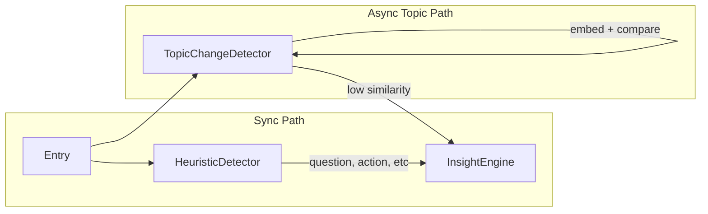

# Topic Change Detection: Remove or Embedding-Based

## Current Problem

The Jaccard similarity approach in [heuristic-detector.ts](desktop/src/main/insights/heuristic-detector.ts) (lines 68–113) is purely lexical:

- "machine learning" vs "ML" = 0 overlap
- "AI" vs "artificial intelligence" = 0 overlap
- Fails on synonyms, abbreviations, paraphrasing
- Triggers on minor wording changes within the same topic

## Option A: Remove Topic Change

**Scope:** Remove the detector entirely.

**Changes:**

- Delete `detectTopicChange`, `tokenize`, `jaccard`, and related constants from [heuristic-detector.ts](desktop/src/main/insights/heuristic-detector.ts)
- Remove `topic_change` from `HeuristicDetector.detect()` and from `disabledTypes` handling
- Remove `detectTopicChanges` from [InsightsSettings](desktop/src/renderer/src/types/settings.ts) and [InsightsView](desktop/src/renderer/src/components/InsightsView.tsx)
- Remove topic change case from [insight-engine.ts](desktop/src/main/insights/insight-engine.ts) (`buildDefaultTitle`, `buildDefaultActions`)
- Remove from [types.ts](desktop/src/main/insights/types.ts) `DetectedEventType`

**Pros:** Simple, no false positives, less code  
**Cons:** No topic change insights

---

## Option B: Embedding-Based Topic Change

**Idea:** Use a small embedding model to compare the new entry with recent entries. If cosine similarity is below a threshold, treat it as a topic change.

### Architecture

### Implementation

1. **New service:** `desktop/src/main/insights/topic-change-detector.ts`
  - Lazy-load ONNX embedding model (e.g. all-MiniLM-L6-v2, ~90MB, 384 dims)
  - Maintain sliding window of last 5 entries + their embeddings
  - `check(entry): Promise<DetectedEvent | null>` — embed entry, compare with mean of recent embeddings via cosine similarity
  - If similarity < 0.5 (tunable) → topic change
  - Handle init failure gracefully (skip when model unavailable)
2. **Model:** Use existing ONNX runtime. Options:
  - **all-MiniLM-L6-v2** — ~90MB, 384 dims, good quality
  - **paraphrase-MiniLM-L3-v2** — smaller (~60MB) if available in ONNX
3. **Integration:**
  - [InsightEngine](desktop/src/main/insights/insight-engine.ts): when `detectTopicChanges` is enabled, call `void topicChangeDetector.check(entry)` after sync detect
  - If topic change fires, emit via same `sendToRenderer` path, with deduplication (reuse `lastEventByType`)
  - HeuristicDetector: remove `detectTopicChange` and `topic_change` from sync path
4. **Tokenization:** Embedding model needs tokenizer. Same pattern as question classifier — use model’s vocab or a compatible tokenizer. Transformers.js could simplify this but adds ~50MB.

### Tradeoffs

| Aspect      | Remove    | Embedding                                |
| ----------- | --------- | ---------------------------------------- |
| Complexity  | Low       | Medium–high                              |
| Latency     | None      | ~20–50ms per entry (async, non-blocking) |
| Model size  | 0         | ~90MB                                    |
| Quality     | N/A       | Semantic, handles synonyms               |
| Maintenance | Less code | Model + tokenizer to maintain            |

---

## Recommendation

- **Option A** if you want to ship quickly and avoid extra complexity.
- **Option B** if topic change insights are important and you’re fine with another ONNX model and async flow.

