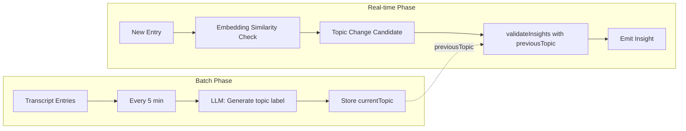

# Topic Detection with Previous Topic Context

## Problem

The `validateInsights` prompt in [llm-service.ts](desktop/src/main/llm/llm-service.ts) asks the LLM to return a topic label when an utterance "introduces a new subject." The LLM only receives:

- `transcriptDelta` (recent transcript text)
- The candidate utterance
- That it was triggered by the embedding heuristic (semantically different)

It does **not** receive the **previous topic**. Without "previous topic was X," the model cannot reliably judge whether the new utterance is a genuine topic shift vs. a tangent, clarification, or continuation.

## Proposed Approach: Batch Topic Generation + Validation

Use a two-phase flow:

1. **Phase 1 (batch):** Every 5 minutes of transcript, generate a topic label for that segment.
2. **Phase 2 (real-time):** When the embedding heuristic triggers a topic-change candidate, pass `previousTopic` to the LLM so it can compare: "previous topic was X, new utterance is Y — is Y a new topic?"




## Implementation

### 1. Topic Segment Tracker (new module)

Create `desktop/src/main/insights/topic-segment-tracker.ts`:

- **State:** `currentTopic: string`, `segmentEntries: TranscriptEntry[]`, `lastTopicTime: number`
- **Config:** `segmentDurationMs` (default 5 min), `minEntriesForTopic` (default 5)
- **Flow:**
  - `addEntry(entry)`: append to `segmentEntries`
  - When `segmentEntries` spans >= 5 min and has >= 5 entries: call LLM to generate topic, store in `currentTopic`, clear segment, update `lastTopicTime`
- **API:** `getPreviousTopic(): string` — returns `currentTopic` or `"N/A"` for first segment
- **Reset:** `reset()` on meeting end

### 2. Topic Generation LLM Call

Add a lightweight method in [llm-service.ts](desktop/src/main/llm/llm-service.ts) (or a small helper):

- **Input:** Formatted transcript segment (last 5 min)
- **Prompt:** "Given this meeting transcript segment, what is the main topic in 2-5 words? Reply with only the topic, no explanation."
- **Model:** gpt-5.6-luna, `max_completion_tokens: 32`
- **Output:** Trimmed string (e.g. "Q3 budget planning")

### 3. Extend InsightEngine Buffer

[insight-engine.ts](desktop/src/main/insights/insight-engine.ts) currently keeps `recentTranscriptEntries` with a 3 min window. For topic generation we need a longer buffer:

- Add `topicSegmentEntries: TranscriptEntry[]` — entries spanning up to 6 min (to cover 5 min segment + overlap)
- Trim by `startTime` when adding entries (keep last 6 min)
- Pass this buffer to `TopicSegmentTracker.addEntry()` (or have the tracker own the buffer and receive entries from the engine)

Simpler option: **TopicSegmentTracker owns its buffer** and receives entries via `addEntry(entry)` from InsightEngine in `onTranscriptEntry`. No need to duplicate — InsightEngine already has entries; we can pass each new entry to the tracker.

### 4. Update validateInsights Signature and Prompt

**LLMService** [llm-service.ts](desktop/src/main/llm/llm-service.ts):

- Add optional param: `previousTopic?: string`
- Update the topic rule in the system prompt:

```
- topic: "N/A" unless the utterance introduces a new subject worth surfacing.
  previous_topic (if provided) was the main topic of the last ~5 minutes.
  Return a short topic label (2-5 words) ONLY when the utterance shifts to a
  genuinely different topic (e.g. previous "Q3 budget" → new "family update").
  Return "N/A" for tangents, clarifications, or same-topic continuation.
```

- Include `previousTopic` in user content when `topic_change` is in `triggeredTypes`:

```
Previous segment topic: ${previousTopic ?? 'N/A'}

${transcriptDelta}
...
```

**InsightEngine** [insight-engine.ts](desktop/src/main/insights/insight-engine.ts):

- Instantiate `TopicSegmentTracker`, pass `generateTopic` callback (LLM call)
- In `onTranscriptEntry`: call `tracker.addEntry(entry)`
- When calling `validateInsights` with `topic_change` in triggered types: pass `previousTopic: tracker.getPreviousTopic()`
- In `reset()`: call `tracker.reset()`

### 5. Wire Topic Generation to LLMService

The tracker needs to call the LLM. Options:

- **A)** Pass `generateTopic: (entries) => Promise<string>` into InsightEngine config; main process provides it via `llmService.generateSegmentTopic(entries)`
- **B)** TopicSegmentTracker receives `llmService` (or a narrow interface) and calls `generateSegmentTopic` directly

Prefer **A** for cleaner separation: InsightEngine stays unaware of LLM details; the config callback is provided by [index.ts](desktop/src/main/index.ts).

### 6. Settings (Optional)

Add to `llm.insights` if desired:

- `topicSegmentMinutes: number` (default 5)
- `topicSegmentMinEntries: number` (default 5)

## Files to Change


| File                                                 | Changes                                                                                        |
| ---------------------------------------------------- | ---------------------------------------------------------------------------------------------- |
| `desktop/src/main/insights/topic-segment-tracker.ts` | **New** — segment buffer, topic generation trigger, `getPreviousTopic()`                       |
| `desktop/src/main/llm/llm-service.ts`                | Add `generateSegmentTopic(entries)`, extend `validateInsights(..., previousTopic?)` and prompt |
| `desktop/src/main/insights/insight-engine.ts`        | Add tracker, pass entries, pass `previousTopic` to validateInsights, reset tracker             |
| `desktop/src/main/insights/types.ts`                 | Extend `InsightEngineConfig` with `generateSegmentTopic?` if using callback                    |
| `desktop/src/main/index.ts`                          | Wire `generateSegmentTopic` from llmService into InsightEngine config                          |


## Edge Cases

- **First 5 min:** `getPreviousTopic()` returns `"N/A"`; prompt still works (LLM uses transcript only).
- **No entries yet:** Skip topic generation until `minEntriesForTopic` reached.
- **Meeting reset:** `tracker.reset()` clears `currentTopic` and segment buffer.
- **Topic gen fails:** Keep previous `currentTopic` (or "N/A"); validation proceeds without it.

